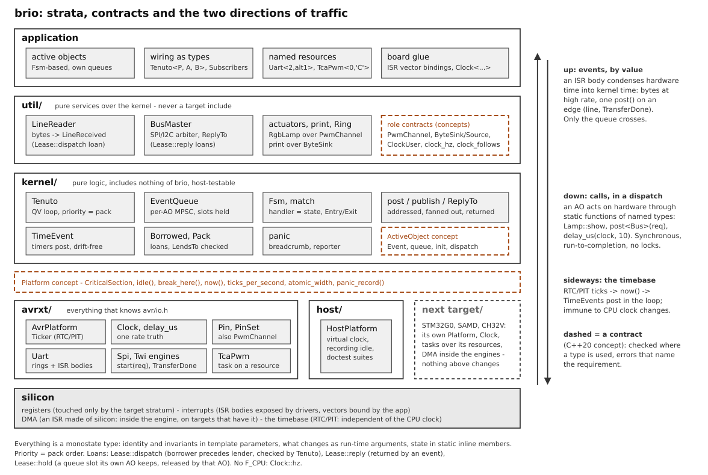

# brio

brio is a framework for programs that run on a bare microcontroller:
no operating system, a few kilobytes of RAM, interrupts and a main loop.
It is for the embedded programmer who has written such programs in C
and wants a structure that keeps them readable as they grow, without a
real-time operating system and without giving up control of the
hardware. It is written in C++, and it does not assume you know C++
beyond what C gave you: the documentation introduces each construct
where a program first needs it.

The name is the musical marking "con brio", for liveliness.

## How a brio program runs

A brio application is divided into components called active objects.
Each one owns a queue of events, small structs that record something
that happened, and a piece of persistent state. The kernel is a loop
that takes one event at a time from the highest-priority queue that is
not empty and hands it to its active object's handler. Interrupt
handlers do one thing with the kernel: they post an event into a queue
and return.

**One handler runs to completion before any other active object runs.**
A higher-priority event that arrives in the meantime waits in its
queue; it does not interrupt the handler that is running. On the next
turn the kernel takes the oldest event of the highest-priority queue
that is not empty, so priority decides what is served next and nothing
more: a long handler delays every other active object, and an object
whose higher-priority peers are always busy is never served. Interrupts
still interrupt a handler, and one interrupt handler never interrupts
another on any platform brio runs on. Keep handlers short, and when
work must continue later, arm a timer or post an event instead of
waiting inside the handler.

Timers are events too: a time event posts its payload to its owner when
it expires, in the loop, so no user code runs inside the tick interrupt.
When every queue is empty the kernel sleeps until the next interrupt.
Everything, active objects, queues and timers, is a static object sized
when the program is compiled; there is no heap in the kernel and no
operating-system thread.

This is the cooperative model of active objects described in Miro
Samek's book, written clean-room from the concepts. The introduction in
[docs/learn/](docs/learn/README.md) explains it from the main loop you
already know, and then reads a complete application one mechanism at a
time.

## What an application looks like

Two excerpts of the maintained example `blink`
([stm32g0/src/apps/blink.cpp](stm32g0/src/apps/blink.cpp), the complete
file), copied as they stand: two of its three event types and the
active object that owns the LED, then the line in `main()` that starts
the kernel. A second active object in the same file, `Supervisor`,
changes the blink period every three seconds by posting a `SetPeriod`
event to this one.

```cpp
struct Toggle {};                      // Blinker's own heartbeat
struct SetPeriod { uint16_t ticks; };  // command: change the blink period

struct Blinker : brio::Fsm<Blinker, Toggle, SetPeriod> {
    static inline brio::EventQueue<Event, 4, P> queue;
    static inline brio::TimeEvent<P, Blinker, Toggle> heartbeat{Toggle{}};

    static void init() {
        Led::output();
        start(&running);
    }

    static Status running(const Event& e) {
        return brio::match(e,
            [](brio::Entry) {
                heartbeat.arm_every(brio::ticks_from_ms<P>(500));
                return handled();
            },
            [](Toggle) {
                Led::toggle();
                return handled();
            },
            [](SetPeriod p) {
                heartbeat.arm_every(p.ticks);  // restart with the new cadence
                return handled();
            },
            [](auto) { return unhandled(); }
        );
    }
};
```

```cpp
    brio::Tenuto<P, Blinker, Supervisor>::run();  // never returns
```

`P` names the platform (the chip) and `Led` the pin, once, in the lines
of the file that belong to the target; the kernel is started after the
clock and the timebase are set up. The list given to `Tenuto` is the
application's active objects in priority order; the compiler generates
the scheduling code from it. `blink` builds unchanged, bar those few
target lines, for the AVR, SAM C21, STM32G0, STM32F4 and CH32V00x
projects.
[The first program, read in stages](docs/learn/first-program.md) walks
through this file.

## The ideas behind it

- Active objects share nothing but events. An object's data is touched
  by its own handlers only, a rule of the design the compiler does not
  check, and handlers never run concurrently, so no handler needs a lock
  against another. Events are copied into queues by value; a buffer
  that must not be copied travels as a pointer with its lifetime rule
  written in the type, and following that rule is the program's duty
  ([kernel.md, "Payloads"](docs/design/kernel.md#4-payloads-what-travels-inside-the-event-kernelborrowedhpp)).
- Posting never waits. A full queue drops the event and counts it,
  which is how an undersized queue is found. Library calls can wait:
  `print` waits until the serial transport has accepted every byte, and
  says so in its header.
- Resolved when compiled. Active objects, drivers and the kernel are
  types; priorities, subscriptions and reply channels are template
  arguments. RAM is what the source declares, and what the kernel
  requires of an active object or of a chip is a C++ concept the
  compiler checks where the type is used, with an error that names the
  requirement.
- Failures leave a trace. A queue overflow is counted; `panic()` writes
  a record that survives a reset before anything else happens.
- The kernel knows no chip. It runs on an 8-bit AVR, on ARM Cortex-M
  cores (M0+, M4F, M33), on RISC-V cores (WCH's QingKe, Raspberry Pi's
  Hazard3) and on the host, where its tests run with a simulated clock.

The design, decision by decision: [docs/design/](docs/design/), starting
with [overview.md](docs/design/overview.md) and
[kernel.md](docs/design/kernel.md).

## Layering



<sub>[open the diagram full size](https://raw.githubusercontent.com/uliano/brio/main/docs/design/architecture.svg)</sub>

The code is grouped into directories called strata, one per layer, and
each stratum may include only the strata below it. An include carries
its stratum's name (`#include "stm32g0/pin.hpp"`), so a file's
portability is readable from its includes: kernel code includes nothing
of brio, a service includes the kernel, a target driver includes both,
and no target include leaves the target strata.

| Stratum | What it holds | Includes |
|---|---|---|
| `kernel/` | queues, the scheduler, state machines, delivery, time events, panic: pure logic | nothing of brio |
| `rt/` | the runtime every 32-bit image compiles: seven functions, one source file ([runtime.md](docs/design/runtime.md)) | nothing of brio |
| `util/` | services over the kernel: serial port and `print`, the bus arbiter with its SPI, I2C and CAN vocabularies, rings, power, storage in flash, meters, the USB device stack, the two-core bridge | `kernel/` |
| `gfx/` | drawing: surfaces, primitives, fonts, text ([gfx.md](docs/design/gfx.md)) | nothing of brio |
| `devices/` | what sits off the chip over a link the chip provides: display controllers and their panel driver | `kernel/`, `util/`, `gfx/` |
| `cortexm/` | what every Cortex-M shares: the interrupt controller and its guard, the SysTick timebase, the microsecond delay | `util/` and the family's device header |
| `pl011/`, `pl022/`, `dw_apb_i2c/` | peripheral blocks licensed to more than one vendor (ARM's UART and SSP, Synopsys's I2C), written once over a traits type each family supplies | `kernel/`, `util/` |
| `avrxt/`, `samc21/`, `stm32g0/`, `stm32f4/`, `ch32v00x/`, `ch32vx03/`, `ch32x035/`, `rp2040/`, `rp2350/` | one stratum per family: the platform type, the clock, the pins and every peripheral driver of that family | `kernel/`, `util/`, and `cortexm/` or an IP stratum where the family carries the block |
| `host/` | the native target: the host platform, simulated chips and devices, the graphics reference renderer | `kernel/`, `util/`, `gfx/`, `devices/` |

What each stratum holds in detail is its own page under
[docs/](docs/README.md). Two families never meet in one binary; where
generic code must behave differently per family, the family states a
fact (its tick rate, its atomic access width) and the generic code
chooses with `if constexpr` or a concept, never with `#ifdef`.

## Targets

A target is supported when its peripheral drivers are implemented and
verified on a board and everything `kernel/` and `util/` claim holds
there; it is in bring-up when the stratum exists, part of it is proven
on silicon, and the rest is still to be validated. This table is the
one place that status is stated; the detail of each family (which
chapters, which boards, which gaps) is in its guide.

| Family | Verified boards | Status | Guide |
|---|---|---|---|
| AVR DA, DB and EA (`avrxt/`) | AVR128DB48, AVR128DA48, AVR64EA48 (self-built boards) | supported | [docs/avrxt/](docs/avrxt/README.md) |
| SAM C21 (`samc21/`) | ATSAMC21J18A (self-built board) | supported | [docs/samc21/](docs/samc21/README.md) |
| STM32G0 (`stm32g0/`) | Nucleo-G0B1RE, Nucleo-G071RB, Nucleo-G031K8 | supported; the learning route's family | [docs/stm32g0/](docs/stm32g0/README.md) |
| STM32F4 (`stm32f4/`) | STM32F429I-DISC1, Nucleo-F446RE, STM32F411CE black pill, 32F469IDISCOVERY | supported | [docs/stm32f4/](docs/stm32f4/README.md) |
| CH32V00x (`ch32v00x/`) | CH32V006K8U6 module, CH32V003F4P6 board | supported; the smallest parts brio runs on (16 KB flash, 2 KB RAM on the CH32V003) | [docs/ch32v00x/](docs/ch32v00x/README.md) |
| CH32V203 and CH32V303 (`ch32vx03/`) | WeAct CH32V203C8T6, WCH CH32V303 evaluation board | CH32V203 supported; CH32V303 in bring-up; CAN not implemented | [docs/ch32vx03/](docs/ch32vx03/README.md) |
| CH32X035 (`ch32x035/`) | WCH CH32X035F8U6 evaluation board | in bring-up: platform, clock, pins and USARTs only | [docs/ch32x035/](docs/ch32x035/README.md) |
| RP2040 (`rp2040/`) | Raspberry Pi Pico, WeAct RP2040 | supported; two cores run two kernels | [docs/rp2040/](docs/rp2040/README.md) |
| RP2350 (`rp2350/`) | WeAct RP2350B | in bring-up: one source built for the Cortex-M33 pair and for the Hazard3 pair, every driver's test suite passing on both; no HSTX, no M33 coprocessors | [docs/rp2350/](docs/rp2350/README.md) |
| host (`host/`) | the host itself | supported: the test suites and the simulators | [docs/host/](docs/host/README.md) |

Compilers: avr-gcc 16.2 for the AVR, arm-none-eabi-gcc 16.2 for the
ARM families and the RP2350's Arm half, WCH's riscv32 gcc 15.2 for the
three CH32V families, an upstream riscv32-unknown-elf gcc 16.2 for the
RP2350's RISC-V half, and a host g++ 16 for the tests. Each target's
guide says where its toolchain is expected and how to point the build
elsewhere. The boards are described one page each in
[docs/boards/](docs/boards/README.md), the probes in
[docs/probes/](docs/probes/README.md).

## Building and testing

The framework is headers under `brio/`, included directly, plus one
source file every 32-bit image compiles (`brio/rt/rt.cpp`). The builds
are sibling CMake projects, one per family plus `test/` and `host/`;
the repository root is not a CMake project. Each project discovers one
application per `src/apps/<app>.cpp` at configure time and gives it a
build target and an `-upload` target.

```bash
(cd test    && cmake --preset host && cmake --build --preset host && ctest --preset host)   # the host tests, no hardware: configure, build, run
(cd stm32g0 && cmake --preset stm32g0b1re-release)                                 # configure one project for one part
(cd stm32g0 && cmake --build --preset stm32g0b1re-release --target blink)          # build one application
(cd stm32g0 && cmake --build --preset stm32g0b1re-release --target blink-upload)   # flash it through the board's probe
```

The test preset runs the suites and does not build them: `ctest
--preset host` alone is for a test tree already configured and built.

The step-by-step version, with prerequisites and expected results, is
[docs/learn/command-line.md](docs/learn/command-line.md); the VS Code
route is [docs/learn/vscode.md](docs/learn/vscode.md). Every other
family follows the same shape with its own project directory, presets
and probe, documented in its guide.

`bin/brio` is the repository's one command for the bench and the checks
(put `bin/` on the PATH): `brio flash <board> <app>` builds for a board
and flashes it whatever its probe, `brio run` drives a test suite's
console and judges its verdict, `brio check <stratum>` compiles the
family fixtures and links every application on every preset,
`brio prose` checks the comments and documents, `brio gate` proves that
a change moved no image. `brio --help` lists the verbs (a verb is the
action name after `brio`).

## Status

The kernel and the services compile unchanged on every family in the
table and are bench-tested on the supported ones: the kernel loop and
time events, a serial console, arbitrated SPI and I2C buses with real
devices on them, the power model with its sleep modes, the flash
storage, the analog and metering services. Each family's own drivers
are covered by the test suites its guide names.

brio is revised freely: nothing below the kernel contract is promised
stable, and when a limitation can be removed by rewriting what sits
below it, the rewrite wins ([overview.md](docs/design/overview.md),
"Governing rule"). What has settled is what reached each new family
unchanged: the active-object contract, the bus vocabularies, the power
model, the storage classes, the clock model.

## License

brio is released under the MIT license ([LICENSE](LICENSE)). The
vendored components under [third_party/](third_party/) keep their own
licenses: doctest (MIT), CMSIS-Core, cmsis-device-g0, cmsis-device-f4
and the SAM C21 DFP (Apache-2.0), and the pico-sdk subset
(BSD-3-Clause).
