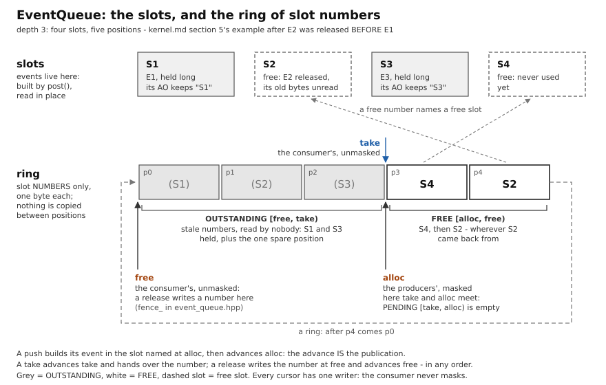

# The active-object kernel

This page decides the contracts of the kernel: what an active object
is and what the kernel requires of it, how events travel and what they
may carry, how the queue works and what it costs, how a state machine
is written, how events are delivered, how the loop schedules, how time
is kept, what happens on a failure, what the chip must provide, and
how a chip with two cores runs two kernels. It is written for an
embedded programmer who knows C and microcontrollers; the learning
route ([docs/learn/](../learn/README.md)) teaches the same model from
the main loop up, and this page is where it sends a reader who needs
the exact rule. The headers under `brio/kernel/` are the reference for
every type and function; this page holds the reasons and the
contracts, and names the header at each heading.

Everything in `brio/kernel/` (one stratum, that is one directory that
is one layer of the framework, [overview.md](overview.md)) is pure
logic, templated on a `Platform` type and never on a specific chip: it includes nothing of a target and
runs on the host, where its tests are. Where a concrete number appears
below it is a measurement on one platform, marked as such, never an
assumption of the kernel.

A word used throughout: a contract is the set of requirements a piece
of code makes on its user and the guarantees it gives in return. Some
of each contract is checked by the compiler; the rest is stated and is
the programmer's duty. The page keeps the two apart.

How to read this page. [The model in one page](#1-the-model-in-one-page)
and [the contract](#2-the-ao-contract-kernelactive_objecthpp) say what an
active object is. The next eight headings follow the life of an event:
[born](#3-events-value-semantics-per-ao-variant),
[carrying a payload](#4-payloads-what-travels-inside-the-event-kernelborrowedhpp),
[queued](#5-queues-kernelevent_queuehpp),
[dispatched by a state machine](#6-state-machines-kernelfsmhpp),
[delivered](#7-delivery-kernelposthpp),
[scheduled](#8-scheduler-kerneltenutohpp),
[timed](#9-time-kerneltimehpp-kerneltime_eventhpp) and
[lost](#10-failures-overflow-and-panic-kernelpanichpp). Then
[what the machine must provide](#11-platform-what-the-machine-provides-kernelplatformhpp),
[two cores](#12-two-cores-two-kernels-and-a-bridge-utilinboxhpp) and
[the index of headers](#13-reference-index). Paragraphs marked
**C++ note** explain a C++ idiom the code relies on, for the reader
who knows C; the idioms are part of the design, not decoration.

## 1. The model in one page

An **active object** is a component of the application that owns a
queue of events and reacts to them one at a time. It is given an event
by the kernel, runs a short piece of code to completion (this is
called **run-to-completion**), possibly posts events to other active
objects, arms a timer or changes state, and returns. Between two
events it holds no local variables and no stack of its own: all its
data is static. The kernel has no way to make an active object wait
and resume it when what it waited for arrives, so an active object
cannot wait for anything inside a handler; if a handler calls a
function that waits for hardware, every other active object on that
core waits with it (under Rubato, every object of its own and lower
priority).

The **kernel** is a loop on the single main stack. Each turn it posts
the time events that have matured, then serves one event from the
highest-priority queue that is not empty, then starts again from the
top. If every queue is empty it sleeps until an interrupt. brio has
two kernels over this one model ([the scheduler](#8-scheduler-kerneltenutohpp)):
`Tenuto`, the cooperative one, under which no other active object runs
while a handler runs on that core; and `Rubato`, the preemptive one,
under which a handler of higher priority may run inside a handler of
lower priority, on the same stack, the lower resuming when the higher
returns. Under both a handler is never re-entered and an object's data
is touched by its own handlers only; what Rubato changes is that the
time a handler takes may contain other objects' handlers, the way it
already contains interrupt handlers. The other concurrency on a core
is an interrupt handler against the dispatches, and an interrupt
handler may do
exactly one thing with the kernel: post an event (`post()`, or on a
two-core chip `send()` to the other core, which ends in a `post()`
there), which builds a
copy of a few bytes in the receiver's queue inside a brief critical
section (a few instructions run with interrupts masked).

The other half of the concurrency model is stated as plainly: **an
interrupt handler runs to completion too; no interrupt handler
interrupts another, on any platform brio runs on.** There are two
contexts, the loop and the interrupt, one boundary between them, and
one primitive that guards it, the platform's critical section. Every
service an interrupt handler touches is built for exactly that
boundary: `EventQueue` masks interrupts around the one copy a post
makes, `MeterLatch` and `Trace` around their one index, and `Ring` is
single-producer single-consumer because one side is an interrupt
handler and the other the loop. An interrupt that could preempt
another interrupt would be a third kind of context, and every driver
whose two vectors share a state machine would become a design
question. brio buys interrupt latency with short handler bodies and
DMA instead, the means the smallest core has: nothing that needed
nesting would run on the AVR, so nothing in brio may need it. Rubato
adds no third context for a driver: peripheral handlers still never
nest, and the exception that starts its scheduler sits below them all.
What it adds is a boundary between two objects' dispatches, closed by
the rule that objects share nothing but events ("Rubato" in
[the scheduler](#8-scheduler-kerneltenutohpp)).

This is the cooperative flavour of active objects described in
Samek's book (he names it QV, for the vanilla kernel), written from
scratch: the concepts come from the book, never from the QP source.

**A chip with two cores runs two of these kernels, not one kernel on
two cores.** Every guarantee above is a statement about one core's
loop. A second core adds exactly one more boundary, core against core,
and the model closes it as it closed the first: a fixed set of
bridges, one primitive per boundary, and no active object ever sees
either. [Two cores](#12-two-cores-two-kernels-and-a-bridge-utilinboxhpp)
states it; `util/inbox.hpp` is the bridge.

Everything is a type with no instances. Active objects, drivers, the
queues' owners and the kernel itself are classes with only static
members, selected by type; such a class is called a monostate.
Priority, wiring and subscriptions are types and template parameters,
resolved when the program is compiled. Nothing is looked up at run
time, and the RAM footprint is the sum of what the source declares.

**C++ note: monostate and `static inline`.** A monostate class is one
where every data member is `static inline` (C++17): the variable is
defined in the header, once per program, with no `.cpp` file and no
initialization-order problem between such variables, because each is
a plain zero-initialized static. `Fsm() = delete;` on the constructor
makes "no instances" explicit. Choosing a monostate by type is what
lets `Tenuto<P, Traffic, Buttons>` visit the active objects with a fold
expression (a C++17 construct that repeats an expression over a list
of types at compile time, shown in
[delivery](#7-delivery-kernelposthpp)) instead of walking a table of
pointers at run time.

## 2. The AO contract (`kernel/active_object.hpp`)

The kernel does not derive active objects from a base class: a
virtual base would force one system-wide event type and cost an
indirect call per event. It states what it needs as a concept, a
compiler-checked list of requirements on a type, named `ActiveObject`:

- a nested type `Event`, the object's own event type, a `std::variant`
  of the structs it accepts;
- a static member `queue`, an `EventQueue`, whose `take()` hands over
  the number of the slot holding the oldest waiting event (or the
  queue's `none`), whose `at()` yields the `const Event&` in a slot,
  whose `take_hold()` says whether the object held the slot it was
  just dispatched from, whose `release()` takes a slot's number back,
  and whose `empty()` answers a `bool`;
- a static `init()`, called once by the kernel's `init_all()` (Tenuto's or Rubato's) in list order,
  before the first event is served; an `Fsm`-based object calls
  `start(&initial)` here;
- a static `dispatch(const Event&)`, which handles one event to
  completion.

That is the **formal half**: names, signatures and return types,
checked by the compiler where an active object enters `Tenuto<...>` or `Rubato<...>`.
The **informal half** is the set of rules the compiler cannot see and
that the kernel is written assuming:

- `dispatch` runs to completion, is called by the kernel only (from
  its loop or, under Rubato, from inside another object's dispatch),
  with interrupts enabled, and is never re-entered; the object's static
  data therefore needs no lock against other active objects, which
  touch nothing of it but its queue, through `post()`, as interrupt
  handlers do;
- the event a dispatch receives stays in its queue slot (the storage
  the queue built it in), and the slot is the consumer's until it is
  released: by the loop right after the dispatch, unless the object
  called the queue's `hold()` inside it, which keeps the slot past the
  dispatch so that the object can read the event again later; the
  object then releases it itself, in a later dispatch of its own
  ([the held slot](#4-payloads-what-travels-inside-the-event-kernelborrowedhpp)).
  A held slot is released once, by its holder;
- `init()` leaves the object in a real state;
- the queue really is an `EventQueue`.

Wherever this page says "contract" it means both halves.

An ordinary active object sees none of this: `dispatch` keeps its
signature, the loop releases what nobody held, and an object that
never calls `hold()` changes not one line. One that holds (the bus
arbiter, [spi-bus.md](spi-bus.md)) keeps the `Held<Event>` that
`hold()` returned, reads the event with `queue.at()` whenever it needs
it, and calls `queue.release()` when it is done. Such an object is
served through its slot, by the loop or by `serve_one<Ao>()` where a
program pumps it by hand, and never by dispatching the copy that
`pop()` returns: that copy has no slot to hold, so a `hold()` there
would hand out the number of a slot `pop()` had already released. Like
the rest of this half, the rule is stated and not checked.

`Fsm<Derived, Alts...>` ([state machines](#6-state-machines-kernelfsmhpp))
is one way to satisfy the contract: it provides `Event` and
`dispatch`. It is not the contract itself. An active object with a
hand-written variant and a switch is a legal citizen. That is why
`active_object.hpp` includes nothing of `fsm.hpp`, and why the `queue`
member is always declared by the object itself: its depth is that
object's sizing decision.

**C++ note: concepts and `requires`.** A `concept` (C++20) is a named
compile-time predicate on types. `ActiveObject<Buttons>` is just
`true` or `false`; nothing happens until a template applies it:
`template <Platform P, ActiveObject... Aos> class Tenuto` (the short
form, where the concept's name replaces `typename`), or a trailing
`requires ActiveObject<Ao>` clause, or a `static_assert`. When a
constrained template is instantiated with a type that fails, the
error names the concept and the requirement that failed. That is the
whole point over plain templates, where the error would be an
unreadable failure deep inside the body. In brio the concepts are the
contracts between strata: `ActiveObject` and `Platform` here,
`ByteSink` and `ByteSource` for the drivers.

## 3. Events: value semantics, per-AO variant

An event is a small struct that can be copied byte by byte (in C++
terms, trivially copyable): `struct Tick {}`, `struct Pressed {
uint8_t which; }`, `struct TempChanged { int16_t c10; }`. Each active
object declares its own event type as a `std::variant` of the structs
it accepts; `Fsm` builds it for you as `Event = std::variant<Entry,
Exit, Alts...>`. There is no global signal enumeration and no
system-wide event type. Plain shared structs are the common language
between publishers and subscribers: two active objects that accept the
same struct both list it in their variant.

Events are copied into per-object queues, with no pools, no reference
counting and no shared ownership, and copied once: `post()` builds the
event in its queue slot and the kernel dispatches it from there, with
no temporary on the way in and no copy on the way out
([queues](#5-queues-kernelevent_queuehpp)). A size of about 8 bytes for
the event envelope is a guideline, not a law: every slot of a queue
pays that object's largest alternative, and the push copies it with
interrupts masked (on an 8-bit core at 24 MHz, about 1 us per 8
bytes). A larger event is legal with numbers in hand, and nobody else
pays for it, because the queues are per object. Measured on one
platform (avr-gcc 16.2, -Os): `std::visit` on a 4-alternative variant
compiles to a plain switch, 30 bytes of flash more and the same RAM as
a hand-tagged union.

Two alternatives are reserved and always first: `Entry` and `Exit`,
empty structs, so they do not enlarge the slots. They are delivered
synchronously by the state-machine machinery and are never posted;
`post()` refuses them at compile time.

**C++ note: `std::variant`, `std::visit`, `match`.**
`std::variant<A, B, C>` (C++17) is a type-safe tagged union: it holds
exactly one of A, B or C and remembers which. Its size is the largest
alternative plus a discriminator and whatever alignment padding the
implementation needs (`sizeof(Event)` says exactly; the learning route
quotes 4 bytes for `blink`'s event on a Cortex-M0+). `std::visit(f, v)`
calls `f` with the alternative currently held, so `f` must be callable
with every alternative. Handlers in brio write

    return brio::match(e,
          { return transition(&green); },
         { lamp_red(); return handled(); },
          { return unhandled(); });

the event first, then one lambda per case, and a `` catch-all
for the rest. Variant dispatch is exhaustive: without the catch-all,
an alternative with no lambda is a compile error; with it, a
forgotten alternative silently takes the catch-all. This is the shape
of `match` in Rust and ML and of the pattern matching proposed for C++
(P2688, not adopted for C++26); `match` here is a four-line library
stand-in in `kernel/fsm.hpp`. Underneath sits the classic C++17
building block, public as `brio::Overloaded`:

    template <class... Ts> struct Overloaded : Ts... {
        using Ts::operator()...;
    };

It inherits from all the lambdas and pulls all their `operator()` into
one overload set, so `std::visit(Overloaded{...}, e)` dispatches by
overload resolution at compile time (class template argument deduction
plus a pack expansion of using-declarations). `match` forwards to
exactly that and compiles to the same switch (measured on two bench
images: flash identical to spelling out the `std::visit` and
`Overloaded` dispatch by hand). `std::variant` needs its alternatives
to be complete types and, for the queue, trivially copyable;
`EventQueue` checks this with a `static_assert`, because an event may
be copied by an interrupt handler, byte by byte, and no destructor
will ever run for it.

## 4. Payloads: what travels inside the event (`kernel/borrowed.hpp`)

The event envelope is copied, so what the struct contains decides the
cost, and, for pointers, the rules. The whole payload rule fits in
three lines:

1. **Copy what is read once.** Descriptors, commands, results, facts:
   by value. Size is a per-object budget
   ([events](#3-events-value-semantics-per-ao-variant)); a larger event
   is legal with numbers in hand.
2. **Borrow only what must be shared.** Storage that hardware or a
   producer writes into, and that would be absurd to copy, travels as a
   pointer, and every such pointer is a loan under one of two leases.
   A lease is the rule saying how long the pointer stays valid:
   - `Lease::dispatch`: valid during the receiving dispatch only. The
     receiver must not keep the pointer for a later event. The sender
     may reuse the storage the next time it runs, which is safe only
     because the receiver runs first: the receiver must precede the
     sender in Tenuto's list, and Tenuto checks that order when the
     program is compiled. The sender is an active object in that list
     (the order has no meaning for anything else); a driver whose
     interrupt handler fills a buffer lends it through the active
     object that owns the driver, as `LineReader` does: the interrupt
     handler writes the driver's ring, and the active object fills the
     buffer it lends in its own dispatch, so nothing writes a lent
     buffer while the borrower reads it;
   - `Lease::reply`: valid until the receiver sends back the completion
     event the protocol agrees on; the reply is the return of the loan.
     Until then the sender keeps the storage valid and follows the
     protocol's access rules (it must not write a buffer the bus is
     reading); after the completion event it may reuse the buffer.
3. **Published payloads travel by value** (or by `const` reference at
   most). N subscribers see the same struct in N sequential dispatches;
   a mutable loan would let each one modify what the next one sees.

The case-by-case then reduces to one question per field: is this data
read once by one receiver, or written by someone else while it is in
flight? The first has one answer, the second has two.

**Why the distinction is safe under either kernel.** Under Tenuto
there is no concurrency between active objects; under Rubato two
objects' dispatches nest but never run at the same time, so two of
them can never write the same buffer at the same instant. The only
hazard of a loan is aliasing in time: the lender reusing storage the
borrower still holds. Both leases pin that down. For `dispatch`, the
list order guarantees that the borrower runs before the lender is
dispatched again: under Tenuto the loop rescans the list from the top
on every turn ([the scheduler](#8-scheduler-kerneltenutohpp)), so a
borrower that precedes the lender has its queue served, and the lent
event with it, before the loop reaches the lender's queue again; under
Rubato the same order makes the borrower's dispatch run inside the
lender's `post()`, so the loan is consumed when the post returns, and
what the lender reads in the storage afterwards is what the borrower
left ("Rubato" there). For `reply`, the boundaries are two explicit events. At
every instant exactly one party has the right to write: ownership
moves, it is never shared.

**How it is written down.** `Borrowed<T, Lease>` is a plain pointer
with the lease in its type: zero cost, trivially copyable, and the
contract becomes readable at the field (`struct LineReceived {
Borrowed<char, Lease::dispatch> line; }`). The lender of a `dispatch`
loan declares its borrowers with `using LendsTo = Subscribers<Sink>;`,
and `Tenuto` refuses at compile time a list in which a borrower
follows the lender: the scheduling contract of the serial stack is a
compile-time fact, not a comment. What the type cannot do is stop a
receiver from saving the raw pointer `.get()` returns and using it
past its lease; C++ has no borrow checker, no run-time check of a loan
exists in any build, and staying inside the lease is the receiver's
duty. `lend<Lease::reply>(buf)` names a loan at the call site, spelled
like `reply_to<Ao, Payload>()`: the lease is the explicit argument, the
pointee type is deduced; a field left out (or `{}`) is a null loan.
Bus transmit, receive and command buffers and the source bytes of a
nonvolatile write are `reply` loans and say so in their field types.
The engine that walks such a buffer calls `.get()` and indexes the raw
pointer, because a loan is a view and not a container.

**The third lease: a held slot.** The two leases above are for what an
event carries. The event itself lives in a slot of its receiver's
queue ([queues](#5-queues-kernelevent_queuehpp)), and the receiver may
keep that slot past the dispatch: `Lease::hold`, valid from the
object's `hold()`, which is legal inside a dispatch and only there,
until the same object's `release()` of it, which it issues in a later
dispatch of its own. The lender is the object's own
queue and the borrower the object, so the rule is one sentence: **a
held slot is released by its holder, and by nobody else.** Another
object releasing it would be a second consumer of the queue, and the
consumer side's freedom from masks rests on there being one. `Held<E>`
is the handle with the lease in its type: the slot's number, one byte,
null by default. It pins the event type, not the holder; the rule
above is what keeps the holder. A holder that lends onward from the
slot for as long as it holds it (a request an engine would read
across a whole transfer) would do it as a `Borrowed<..., Lease::hold>`;
no engine does today, each keeping its own copy of the request, a
choice each family's bus round revisits. The loop's `const Event&` is
not a lease at all: it is the event's own lifetime, which for an
event nobody holds ends with its dispatch. Like the other two, the
lease names the rule at the point of use and does not enforce it.

**In use today.** `LineReceived` lends the line buffer for one
dispatch, mutable, because tokenizing the line in place is the point.
Bus requests travel by value: the request is the arbitration token, a
few tens of bytes of addresses, lengths and the select, copied once
into the bus queue by `post()` and once more by the engine that keeps
it, the arbiter holding the slot while the request waits and while it
is on the wire and reading it there ([spi-bus.md](spi-bus.md)'s copy
accounting). The request lends its data buffers until `BusDone`. The
borrowed surface is the structurally necessary minimum. Nothing is
ever chopped into several events: one event is one envelope, and the
cargo stays put.

**Fan-out cost.** `publish()` is one `post()` per subscriber: N
subscribers mean N copies of the envelope, in N queues, one critical
section each. Fine for small notifications; a large published payload
would be N times wrong, which is why facts are small structs. Replies
([delivery](#7-delivery-kernelposthpp)) are ordinary posted events
too: the service copies the small result struct into the requester's
queue.

**One more discipline, kept for the future.** Active objects share
nothing but events. An object's own statics are safe because its
dispatch is never re-entered, but a global touched by two objects
outside events is safe only under Tenuto; under Rubato it is a race,
and a service two objects call directly has one owner object or
guards its producers ("Rubato" in
[the scheduler](#8-scheduler-kerneltenutohpp)). The rule costs nothing
under Tenuto and is what makes a program ready for Rubato.

## 5. Queues (`kernel/event_queue.hpp`)

One `EventQueue<E, depth, Platform>` per active object, with many
producers (any interrupt handler, any main-loop code, any timer) and a
single consumer (the object's dispatch context: the loop, and the
object itself when it holds a slot). The kernel assumes no atomic
read-modify-write instruction from the machine, since the smallest
cores have none, so the honest primitive for the producers is a brief
interrupts-off section, the platform's `CriticalSection`, and the
consumer takes no mask at all. There are deliberately no
`*_from_isr` twins: one always-safe `push`.

[open the diagram full size](https://raw.githubusercontent.com/uliano/brio/main/docs/design/event-queue.svg)

### Two things kept apart: the slots and the ring

A queue is two arrays, and the whole design is in keeping them apart.

- The **slots**, `depth + 1` of them, each the size of the object's
  `Event`. `post()` builds an event in a slot (a variant's alternative
  constructed there, under the mask: the one copy a post makes), and
  the event stays in that slot, read in place by its dispatch, until
  the slot is **released**: by the loop right after the dispatch, or
  later by the object when it held it.
- The **ring**, `depth + 2` positions of one byte each, holding slot
  numbers (`S1`, `S2` ... below) and nothing else. Nothing in the ring
  is an event, and nothing is ever copied from one position to
  another: what moves is three cursors, and what is written is one
  byte at a time.

Both arrays live inside the queue, in the object's static storage: the
linker places them and nothing allocates a slot at run time.
"Allocating" is taking the number at the `alloc` cursor. A static
queue starts all zero, in `.bss`: each number is stored XOR its place
in the array and the slots are numbered from 1, so an all-zero ring
reads as every slot in the free run, in order, and no code fills it
([`event_queue.hpp`](../../brio/kernel/event_queue.hpp), "Why a static
queue is all zero").

### Three runs, three cursors

The cursors cut the ring, in ring order, into three runs:

| run | from | to | its positions hold |
|---|---|---|---|
| pending | `take` | `alloc` | the numbers of built events, oldest first |
| free | `alloc` | `free` | the numbers of empty slots, in the order the producers will use them |
| outstanding | `free` | `take` | the positions of slots taken and not yet released; nobody reads them, except the last one, which `hold()` reads back |

- `alloc` is the producers' cursor, written only under the mask. A
  push reads the number at `alloc`, builds the event in that slot and
  advances `alloc`: the advance moves the number from the free run into
  the pending run, and is the publication. Allocation order is push
  order, so the free run doubles as the order of the pending one: one
  ring, not two.
- `take` and `free` are the consumer's, written without a mask. A take
  reads the number at `take` and advances it: the slot is now
  outstanding and its event is dispatched where it lies. A release
  writes the slot's number at `free` and advances `free`, whichever
  slot it is, in whatever order the slots come back.
- The ring has one position more than there are slots. The
  outstanding run therefore always keeps a spare position while
  anything is outstanding, and each test reads one pair of cursors:
  the pending run is empty when `take` meets `alloc`, the free run when
  `alloc` meets `free`. No count is shared between the two sides.
- The code names the `free` cursor `fence_`: the position after the
  free run, where the next release writes; zero at the start, when the
  free run is every slot.

### The example, step by step

Four slots (`depth` 3), numbered 1 to 4, S1 to S4, so five positions
`p0` to `p4`. In the tables a number in parentheses is stale: left
behind in the outstanding run and read by nobody. A dash is a position
never written.

**Start.** Every slot free, the spare position at the end.

| | p0 | p1 | p2 | p3 | p4 |
|---|---|---|---|---|---|
| number | S1 | S2 | S3 | S4 | - |
| run | free | free | free | free | outstanding |
| cursors | take, alloc | | | | free |

**E1 arrives and is held long.** A producer finds S1 at `alloc` (p0),
builds E1 in S1 and advances `alloc` to p1. The loop takes it (`take`
to p1), dispatches E1 in S1, and the object holds it: from now on the
object keeps the number S1, which never moves.

| | p0 | p1 | p2 | p3 | p4 |
|---|---|---|---|---|---|
| number | (S1) | S2 | S3 | S4 | - |
| run | outstanding | free | free | free | outstanding |
| cursors | | take, alloc | | | free |

S1 = E1, held.

**E2 arrives, held medium.** S2 from p1; `alloc` and `take` to p2.

| | p0 | p1 | p2 | p3 | p4 |
|---|---|---|---|---|---|
| number | (S1) | (S2) | S3 | S4 | - |
| run | outstanding | outstanding | free | free | outstanding |
| cursors | | | take, alloc | | free |

S1 = E1 held, S2 = E2 held.

**E3 arrives, held long.** S3 from p2; `alloc` and `take` to p3. One
free slot is left, S4.

| | p0 | p1 | p2 | p3 | p4 |
|---|---|---|---|---|---|
| number | (S1) | (S2) | (S3) | S4 | - |
| run | outstanding | outstanding | outstanding | free | outstanding |
| cursors | | | | take, alloc | free |

S1 = E1 held, S2 = E2 held, S3 = E3 held.

**E2 finishes before E1.** Its holder releases S2: the number is
written at `free` (p4) and `free` moves on, wrapping to p0. The old S2
at p1 stays behind as a stale number in the outstanding run, read by
nobody; S1's position is not touched, and that S1 is older does not
matter, since a release goes to the end of the free run whatever its
order. This is the state the diagram draws.

| | p0 | p1 | p2 | p3 | p4 |
|---|---|---|---|---|---|
| number | (S1) | (S2) | (S3) | S4 | S2 |
| run | outstanding | outstanding | outstanding | free | free |
| cursors | free | | | take, alloc | |

S1 = E1 held, S3 = E3 held, S2 and S4 free.

**E4 arrives, is fast, and is released at once.** The producer finds
S4 at p3 and advances `alloc` to p4; the loop takes it (`take` to p4),
dispatches it, the object does not hold it, and the loop releases S4:
the number is written at `free` (p0), `free` to p1.

| | p0 | p1 | p2 | p3 | p4 |
|---|---|---|---|---|---|
| number | S4 | (S2) | (S3) | (S4) | S2 |
| run | free | outstanding | outstanding | outstanding | free |
| cursors | | free | | | take, alloc |

**E5 arrives and takes S2, while S1 and S3 are still held.** The
producer finds S2 at p4, builds E5 in it and advances `alloc`,
wrapping to p0. Until the loop takes it, all three runs are on the
ring at once.

| | p0 | p1 | p2 | p3 | p4 |
|---|---|---|---|---|---|
| number | S4 | (S2) | (S3) | (S4) | S2 |
| run | free | outstanding | outstanding | outstanding | pending |
| cursors | alloc | free | | | take |

**Then E5 is served and released, and E1 and E3 finish, in any
order.** Each release writes one number at `free`: S2 at p1, then,
say, S1 at p2 and S3 at p3, `free` ending at p4. The free run is p0 to
p3 again, the spare position is p4 again, and the slots come out in a
new order, S4, S2, S1, S3, which nothing cares about.

| | p0 | p1 | p2 | p3 | p4 |
|---|---|---|---|---|---|
| number | S4 | S2 | S1 | S3 | (S2) |
| run | free | free | free | free | outstanding |
| cursors | take, alloc | | | | free |

### The questions a reader asks

**Is anything copied?** One event, once: by `post()`, into its slot.
After that every operation writes one byte, a cursor or a slot number
at `free` on a release. A held event is never moved, however long it
is held and however many events pass beside it.

**Does anybody point into the ring?** No. A holder keeps the slot's
number (a `Held<E>`,
[the third lease](#4-payloads-what-travels-inside-the-event-kernelborrowedhpp)),
which is fixed from `post()` to release; positions are the queue's own
bookkeeping, and they can move under nobody's feet because nobody
outside the queue knows them. `take()` returns the number and `at()`
the event in that slot.

**What if a slot is released twice?** Nothing checks it, and the queue
is corrupted for good: the second release writes a number the free run
already holds, so the queue reads full for ever (every push refused,
`size()` zero, `overflows()` climbing) or hands one slot to two
producers. One holder, one release: the lease's rule is what keeps it.

**Why does the consumer never mask?** Every cursor is written by one
side only: `alloc` by the producers (serialized among themselves by
the mask), `take` and `free` by the consumer. A producer reads only the
free run, which the consumer filled before it moved `free`; the
consumer reads only the pending run, whose positions nobody has
touched since a producer wrote them; the consumer writes only the
outstanding run, which no producer reads. A cursor is one byte, one
access on every platform (`atomic_width`), and between a slot or a
position and the cursor that publishes it sits a compiler-only fence,
`std::atomic_signal_fence`, `Ring`'s idiom. A compiler fence suffices
because the other side runs on the same core, as an interrupt handler
of the code it interrupts or as the code an interrupt handler returns
to, and a core sees its own stores in program order; a second core
would not ("The queue belongs to one core", below). An empty queue
costs the consumer two loads and a compare.

**Why is a static queue still in `.bss`?** Every kernel static is all
zero at boot and costs neither flash nor a copy at startup. The queue
too, whenever its event's value-initialized state is all zero, as
every `Fsm` event's is (`Entry`, the first alternative, carries
nothing); an event type with non-zero defaults makes it a `.data`
image. The ring's natural first state, the slots' numbers in order
with `free` at the end of them, is not zero. Three choices make it
zero, and they cost the producers' masked window one XOR. `free` is
stored as the position after it, the fence, zero at the start: the
producer computes the position after `alloc` anyway to publish, and
the queue is full when that meets the fence, the same test. Each
position is kept one place ahead in the array, so the place a release
writes is the fence and the place a take reads is the next position
it computes anyway, with no step back anywhere. And each number is
stored XOR its place in the array, with the slots numbered from 1: the
first state, number i at place i, reads zero, and the spare position
reads 0, the `none` an empty `take()` returns. Without these choices
the whole queue, slots included, would be an initialized object in
flash, copied at every boot.

**How big must a queue be?** A count, not a time. `depth` is the
number of events that can be waiting or held at once while a dispatch
is in progress: the queue holds `depth + 1` slots, the extra one for
the event being dispatched, so a post from inside a dispatch (an
object posting to itself) finds `depth` places like a post from
anywhere else. The overflow moment, in one rule: **a push is refused
when every slot is occupied, waiting or outstanding** (being
dispatched, or held). With nothing being dispatched and nothing held,
the spare slot takes a waiting event too, so an idle queue accepts
`depth + 1`; each hold takes one of the `depth` for as long as it
lasts. An object therefore sizes its depth as the events it holds at
once plus its waiting peak, never from how long a hold lasts: a hold
costs exactly its own slot for any duration, and whether something
held ever ends (a transfer that never answers) is liveness, which
belongs to the holder (a bus's timeout), not to the queue.
`capacity()` answers `depth`, `size()` the events waiting. Depth may
be any number from 1 to 254: the slot numbers 1 to `depth + 1` are
bytes, and 0 is the `none` an empty `take()` returns. There is no
power-of-two rounding, which would spend real RAM to speed up a wrap
that is already two instructions.

### Why not the obvious ring with a release cursor

The obvious way to let an object keep a slot is a plain ring of events
with a fourth cursor trailing the take: a slot is freed when the
cursor passes it. But the cursor passes in order, so a slot is free
only once every slot before it is. One long hold blocks every slot
behind it, each event dispatched after it keeping its slot until the
hold ends: head-of-line blocking. Simulated on one arrival stream
beside the design above, that ring lost 0.55 slots per dispatch for as
long as a hold lasted and refused every push within a few dozen turns
at any real depth, in every release order; the ring of slot numbers
lost exactly the hold's own slot at every duration and in every order
(`test_event_queue`'s capacity cases). Keeping the numbers apart from
the events is what buys it: a released number goes to the end of the
free run, wherever it came from.

### Where the queue stops

`Ring` (single producer, single consumer, [ring.md](ring.md)) is not
the event queue: it stays at the byte level inside drivers. The
interrupt handler pushes bytes lock-free, and the driver's active
object condenses them into few events (bytes at a high rate, events at
a low rate).

**Overflow** is a sizing mistake, not a run-time condition. `push`
never blocks and never returns failure: a full queue drops the event
and increments a saturating per-queue counter, a named static symbol
readable from the debugger (`overflows()`), nearly free in release.
The queue itself only counts; whether a program keeps running on an
overflow or panics on it is the layer above's decision, and
`PanicCode::queue_overflow` exists for a program that reads the counter
and chooses to panic. There is no bool-returning post spreading
untested error branches.

**The queue belongs to one core.** Its critical section masks the
interrupts of the core that takes it, so on a chip with two cores a
push from the other core would race the owner. The queue names its
platform (`EventQueue::Platform`), and a platform that can tell which
core is running (`on_own_core()`,
[the platform](#11-platform-what-the-machine-provides-kernelplatformhpp))
makes `push` refuse a copy from the wrong core before it touches
anything: dropped and counted as a **mispost**, the same economy as
overflow, and a witness of a programming error rather than a
statistic. A single-core platform has no such member, and its queues
carry neither the check nor the counter's byte.

### What it costs

Read in the release listing of a three-object image with an interrupt
that posts a one-byte event. The producers' masked window is within an
instruction of a plain ring's either way: the free-run test replaces a
counter subtraction, one byte load and one XOR are added. It is 23
instructions on the AVR128DB48 (31 cycles), 21 on the STM32G0B1RE's
Cortex-M0+, 18 on the STM32F446RE's Cortex-M4F, 22 on the CH32V006's
QingKe V2. The consumer pays for the release: the queue's share of
serving one event (take, the slot's address, the hold test, the
release) is 36, 30, 27 and 31 instructions where a ring that freed its
slot at the next take spent 17, 15, 13 and 15. On the AVR that is 23
cycles more, about a microsecond at 24 MHz, unmasked, beside a
dispatch of a hundred cycles and up. A hold costs nothing on the path:
`hold()` reads the slot's number back from the position the take just
left. RAM: `depth + 2` bytes per queue more than such a ring, the slots
unchanged, all of it in `.bss`. These are the figures of a loop that
inlines take and release.
In an image with a bus arbiter the compiler keeps `release()` out of
line, because the arbiter releases from several places, so a release
on that queue is a call more (read on the STM32G0B1RE's SPI suite).

**C++ note: `std::optional` returns, and a number for a place.**
`pop()`, a take with a copy out and the slot released at once, for
code that drains a queue by hand (a test, or a program pumping an
object that does not hold), returns `std::optional<E>` (C++17): "an E,
or nothing". The caller writes `if (auto e = q.pop()) dispatch(*e);`
and cannot forget to test, where a `bool pop(E& out)` would leave a
half-written out-parameter around. A project style rule: optional
returns instead of a bool and an out-parameter. `take()` returns a
slot number instead, because what it hands over is a place and not a
value, and a number rather than a pointer because the release needs
the number back and recovering it from a pointer is a division by
`sizeof(E)`. Its "nothing" is `none`, the one value no slot can have,
which costs nothing where an `optional<uint8_t>` would cost a byte and
a test.

## 6. State machines (`kernel/fsm.hpp`)

A flat state machine, with a contract written so that a hierarchical
one could be added without changing it. `Fsm<Derived, Alts...>` is the
monostate base an active object derives from; it gives the object its
`Event` (the variant with `Entry` and `Exit` prepended) and its
`dispatch()`.

- A **state is a handler function** `Status handler(const Event&)`,
  and the current state of the machine is a pointer to it: one
  function pointer of RAM, one indirect call per dispatch.
- The handler returns `handled()`, `unhandled()` or
  `transition(&next)`. `unhandled` means "ignore" today; in a
  hierarchical extension it would mean "ask the parent state", which
  is the hook that makes such an extension additive rather than
  breaking. The `Status` it returns is one handler pointer wide: null
  for handled, a private marker's address for unhandled, the next
  state for a transition. So it comes back in a register on every
  core; a kind stored beside the pointer made it two words, which the
  Arm calling convention returns through memory (measured on the
  Cortex-M0+ as a `memset` at every return).
- A **transition** delivers `Exit` to the old state, switches the
  pointer, and delivers `Entry` to the new one. `Entry` may itself
  return `transition()`: the machinery follows the chain, so a
  pass-through state costs nothing. `Exit`'s return value is ignored:
  exit is an action, not a decision. An entry chain that never settles
  spins for ever; keep entries simple.
- `start(&initial)` arms the machine and delivers the first `Entry`,
  so no state ever runs half-initialized. The object calls it from
  `init()`, which the kernel calls before the loop starts.
- An object whose behaviour does not depend on history keeps one state
  for its whole life, and may use a plain switch inside it.

A full hierarchical state machine (parent pointers, bubbling, the
entry and exit chains through the lowest common ancestor) is built
only when a real active object demands it. States as types, in the
style of some C++ state-machine libraries, was rejected as a
foundation: the heaviest machinery, hostile errors, and readability
drops.

**C++ note: the derived type as a template argument.** In `struct
Buttons : brio::Fsm<Buttons, Tick>`, the class being defined passes
its own type as the first template argument (a form often called the
Curiously Recurring Template Pattern). Here it is not used to call
back into the derived class; it exists so that the `static inline
Handler state_` inside `Fsm<Buttons, Tick>` is a different variable
from the one inside `Fsm<Traffic, Tick>`: two objects with the same
alternatives get distinct machines. The state pointer type `Status
(*)(const Event&)` is a plain function pointer: handlers are static
functions, with no `this` and no virtual table.

## 7. Delivery (`kernel/post.hpp`)

Three primitives, one rule each:

- `post<Ao>(ev)`: **commands are addressed**. The event goes to one
  named active object. It requires only that `Ao::Event` can be
  constructed from `ev`'s type; `Entry` and `Exit` are refused by a
  `static_assert`. Safe from interrupt handlers and from the loop
  alike, and it never waits: a full queue drops the event and counts
  it.
- `publish(Subscribers<A, B...>{}, ev)`: **facts are published**. One
  `post` per listed subscriber, in list order, with `post`'s rules and
  from any context of the core the subscribers live on. The subscriber
  list is
  a type built where the publisher is declared, so a subscription that
  cannot be received (the subscriber's variant lacks the struct) fails
  to compile at that line.
- `ReplyTo<Payload>`: **replies return to sender**. A capsule of one
  function pointer, trivially copyable, that travels inside the
  request event, built at compile time by `reply_to<RequesterAo,
  Payload>()`. The service calls `req.reply.send(payload)` without
  knowing who asked. A default-constructed capsule is null and
  `send()` does nothing, so a fire-and-forget request costs nothing. A
  requester whose variant cannot hold `Payload` fails to compile at the
  `reply_to` site. This is the return channel of every bus active
  object, whose request queue doubles as the bus arbiter.

All three are one core's primitives. The fourth, `send<Ao>(ev)`, is the
crossing function of a two-core chip
([two cores](#12-two-cores-two-kernels-and-a-bridge-utilinboxhpp)): an
event to an active object that lives on the other core, through its
inbox and a doorbell, callable from the loop or an interrupt handler
of the sending core. `send_reply_to<Ao, Payload>()` builds the capsule
of a request that crosses, whose reply crosses back the same way.

**C++ note: fold expressions and thunks.** `publish` is one line,
`(post<Aos>(e), ...);`, a C++17 fold over the parameter pack with the
comma operator, expanding to `post<A>(e), post<B>(e), ...` at compile
time; there is no loop and no table. `Tenuto::step()` uses the same
device with `||` (`(try_one<Aos>() || ...)`), which is what makes
priority equal to list order: the fold stops at the first non-empty
queue. `ReplyTo` stores a pointer to a thunk, a static function
template `thunk_for<Ao>` whose only body is `post<Ao>(p)`;
instantiating it for a given active object bakes the destination into
the code, so the capsule needs no data beyond the pointer. (A thunk
is a function that exists only to forward a call to a destination
fixed when it was generated.) `TimeEvent` fires its payload with the
same trick (`do_fire`), and the state machine's state pointer is the
third instance of "a function pointer instead of a virtual call".
`requires std::constructible_from<typename Ao::Event, Ev>` on `post`
is a trailing requires-clause constraining a single function template
rather than a named concept, used when the requirement is local to
one function.

## 8. Scheduler (`kernel/tenuto.hpp`)

The cooperative kernel is `Tenuto`, the type in `kernel/tenuto.hpp`:
the musical marking for a note held for its full value, which is
run-to-completion said in one word.

`Tenuto<P, Ao1, Ao2, ...>`: the active objects are the template
parameter list, in C++ terms the pack, and **priority is the order of
the list**, first is highest; there is no separate priority table to
keep coherent. Because the order is a type, the pack answers ordering
questions at compile time (`Pack<Aos...>::index<Ao>()`), and Tenuto
uses that to enforce the one ordering fact the payload rule needs:
every `Lease::dispatch` borrower precedes its lender
([payloads](#4-payloads-what-travels-inside-the-event-kernelborrowedhpp)).
Tenuto also refuses an active object whose queue belongs to another
platform, which on a chip with two cores means another core.

The loop (`run()`), one turn:

1. `TimeEvents
::process()`: post every matured time event, in the
   loop's context ([time](#9-time-kerneltimehpp-kerneltime_eventhpp)).
2. `step()`: take one event from the highest-priority non-empty queue,
   dispatch it in its slot, to completion, and release the slot unless
   the object held it (`serve_one<Ao>()` in
   `kernel/active_object.hpp`, the same step a program that pumps an
   object by hand calls). For the dispatch's duration the kernel keeps
   the object's list index in `dispatching
` (`no_dispatch`, 255,
   outside every dispatch), so a service called from inside a dispatch
   knows which object called it without the object naming itself (the
   first such service is a port's writer, `util/line_writer.hpp`'s
   `LineWriter`, which keeps each object's open line in a buffer of its
   own by that index, [serial.md, "LineWriter"](serial.md#linewriter-utilline_writerhpp)); the
   same step under Rubato sets the inner object's index for a nested
   dispatch and puts the outer one's back after it. An interrupt
   handler reads the index of the dispatch it interrupted, which is why
   a service that handlers may call asks the platform's `in_handler()`
   first ([the platform](#11-platform-what-the-machine-provides-kernelplatformhpp)).
3. If `step()` found nothing, `idle_if_empty()`: re-check every queue
   with interrupts masked and, if still empty, call `P::idle()`, which
   re-enables interrupts and sleeps in a way that leaves no window for
   a lost wake-up (a promise every platform's suite measures, with the
   one measured exception stated with the platform's promises in
   [the platform](#11-platform-what-the-machine-provides-kernelplatformhpp)).
   How that is done is the platform's business: the
   classic sequence is "enable, then sleep" on a core where the enable
   takes effect only after the following instruction; a core whose
   wait-for-interrupt instruction wakes on a pending interrupt even
   while masked does it the other way round. The kernel relies on the
   contract alone. A platform whose timebase keeps counting while the
   core sleeps may offer the optional `idle_until(deadline)` instead
   ([the platform](#11-platform-what-the-machine-provides-kernelplatformhpp)):
   under the same mask the loop hands it the absolute tick of the
   nearest armed time event (`TimeEvents
::next_deadline()`, empty
   when nothing is armed), and the platform places its wake there and
   sleeps through the whole wait with no periodic tick at all. The hook
   is detected with a `requires` expression, so a platform without it
   is compiled exactly as before, and the loop's structure does not
   change: it still posts the events itself on the next turn.

`init_all()` runs every object's `init()` in list order before the
first turn. Host tests drive `init_all()` and `step()` directly, since
`run()` never returns.

What the scheduler promises, and what it does not. A dispatch runs to
its end before any other active object runs. On the next turn the loop
rescans the list from the top and takes the oldest event of the first
non-empty queue, so an event posted during a dispatch waits at least
until that dispatch returns, and longer when an older event is ahead
of it in the same queue or a queue of higher priority is not empty.
The list order is a selection precedence, not a share of the
processor: the kernel promises no response time beyond "the running
dispatch finishes first", and no fairness. A long dispatch delays
every other object by its length, and an object whose higher-priority
peers always have an event waiting is never served; the kernel does
not age priorities. Such a design shows in the per-queue overflow
counters once its queues fill, and keeping every dispatch short, every
queue sized for its bursts and the sustained rate of the
higher-priority producers low enough is the application's side of the
model. A program that needs more is a different kernel's.

The shallowest sleep keeps peripherals alive; deeper modes are
application policy, not the kernel's business. They are negotiated
above the kernel by the power model ([power.md](power.md)), which arms
a mode and lets this same hook take it, so the loop is unchanged and a
program without a power manager pays nothing.

### Rubato, the preemptive kernel (`kernel/rubato.hpp`)

`Rubato<P, Ao1, Ao2, ...>` is the second kernel: the same list, the
same objects, queues, state machines, delivery primitives, time events,
loans and panic path, and the same compile-time checks plus one, fewer
than 255 objects, since a list index is a byte. Its name is the
musical marking for tempo stolen from one note and given back to
another. What it adds is one thing: **the dispatch of a higher-priority
object may start while a lower-priority dispatch is suspended, on the
same stack, and the suspended one resumes when the higher one
returns.** Nothing is ever suspended in the other direction: an object
of equal or lower priority than the one running waits, as under Tenuto.

The ceiling. The platform keeps one byte, `P::ceiling`: the list index
of the object being dispatched, 255 at the loop's base, and 0 while
nothing may be dispatched at all (during `init_all()`'s inits and while
the loop posts the matured time events). "Above the ceiling" in what
follows means a smaller index, that is a higher priority. Only an
object whose index is below the ceiling may start a dispatch. Every
`post()` compares the receiver's index with the ceiling after the copy
and, when it is below, asks the platform for the scheduler
(`P::pend_schedule()`); the compare reads the ceiling once, and a
request that finds its queue already served by a scheduler that ran in
between serves nothing and costs one pass of the scan. The raise of
the ceiling before a dispatch and its restore after are compiler
barriers in the kernel (`std::atomic_signal_fence`, no instruction on
one core): without them the compiler may move the queue's reads ahead
of the raise, and a request landing in that gap serves the event in a
nested scheduler while the outer pass takes it again from a stale
cursor and releases the slot twice, which wedges the queue (seen on
the STM32F446RE under GCC 16 at `-Os`, in the bench suite below).
The scheduler is `activate()`: it serves the highest non-empty queue
below the ceiling, one event, with the ceiling raised to that object's
index for the length of the dispatch and restored after it, and repeats
from the top of the list until no queue below the ceiling holds
anything. Each queue knows its index because `init_all()` writes it
(the pack index, kept in the queue on a preemptive platform only),
and `init_all()` holds the ceiling at 0 while the inits run, so nothing
is dispatched before the last `init()` has returned.

Two roads lead to a dispatch that preempts another:

1. An interrupt handler posts to an object above the ceiling. The
   request waits for the handler to end; at its exit the platform runs
   `activate()`, so the higher object's dispatches run to their end
   over the code the interrupt suspended, which resumes after them.
2. A dispatch posts to an object above it. The platform runs
   `activate()` at once, inside `post()`, which returns after the
   receiver's dispatches have run to their end.

A post to an object at or below the ceiling, the poster itself
included, waits as under Tenuto: until no dispatch of its receiver's
priority or higher is running or suspended, and then in list order.
`publish` is one post per subscriber in the subscriber list's order,
each of which may run its receiver's dispatch inside it before the
next. How the platform tells a handler's call of `pend_schedule()`
from a dispatch's is its own: the exception mechanics on a Cortex-M,
the interrupt controller's preemption levels on a QingKe V4, the global
mask on the RP2350's Hazard3 (clear in every handler, set by the
scheduler's entry before any dispatch), a flag the harness raises on
the host.

What never changes. A handler is never re-entered, and an object is
never dispatched while one of its own dispatches is suspended, because
its index is never below a ceiling raised to it; so an object's own
statics need no lock and its queue keeps one consumer. A dispatch still
runs to its end before any object of its own or lower priority runs.
Nothing blocks, nothing has a stack of its own, nothing is sliced in
time; the kernel loop at its base is Tenuto's turn (the matured time
events posted with the ceiling held at 0, so that no fire dispatches
and the scheduler then serves them in priority order; the scheduler;
sleep when every queue is empty), and a preempting dispatch never
sleeps. The two-core model is unchanged: a Rubato per core, the
doorbell's handler an interrupt handler like any other. Where two cores
share one vector table, as on the RP2040 and on both halves of the
RP2350, the one entry of the scheduler's exception serves two kernels
through a body that asks which core took it: five cycles a request
more than the single body on the RP2040 by the release listing (the
single body's own path is not measured there), three on the RP2350's
Cortex-M33, measured, and two on its Hazard3 by that core's model; a
table per core would spare them at the price
of a second table every bound vector must be kept in step with, and is
declined. The body that asks is measured on both chips, a Rubato on
each core preempting at once through the one entry ([the RP2040
platform page](../rp2040/platform.md), [the RP2350 platform
page](../rp2350/platform.md)).

The loans ([payloads](#4-payloads-what-travels-inside-the-event-kernelborrowedhpp)).
A `Lease::dispatch` borrower precedes its lender in the list, so a loan
posted from the lender's dispatch starts the borrower's dispatch inside
the post: the borrower reads the storage, and may write it, before
`post()` returns, and its lease ends there. The lender may reuse the
storage from then on, within the same dispatch; what it may not do is
read the lent storage after the post expecting what it put there,
which under Tenuto it would have read only at its next dispatch.
`Lease::reply` and `Lease::hold` are unchanged.

What two objects may touch outside events. Under Tenuto a structure
two objects call directly is safe because their dispatches never
overlap; under Rubato two objects of different priority run one inside
the other, so **a service called directly by two objects has one owner
object, or guards its producers.** Two structures guard themselves on
a preemptive platform: the armed time events
([time](#9-time-kerneltimehpp-kerneltime_eventhpp)) and the producer
verbs of a `Ring` ([ring.md](ring.md)); the guard covers each verb, not
a run a producer fills between `write_span()` and `publish()`, so a
transmit ring two objects write is corrupted inside a run, and the one
owner is the rule there. A polled loop a service runs inside its own
dispatch (the bus arbiter's loop with two frames in flight) is held off
by every dispatch above the service for that dispatch's whole length,
which the service's hold-off figure, the image's longest handler or
masked window, does not count: under Rubato the hold-off is the
longest dispatch above the service, and a preemption that outlasts a
frame ends the transaction with the status the service detects
(`spi_overrun` on the STM32F4 and on the CH32V203 and CH32V303,
measured: the service never hands back a run with a hole, the requester
sees the status; `spi_stalled` on the CH32X035, whose polled loop does
not read the overrun flag, by its release listing and not measured);
where the
write-ahead is a receive FIFO that holds every frame in flight (the
STM32G0's SPI and the PL022 of the RP2040 and the RP2350, measured), or a write-ahead of two against a two-level
receive buffer (the SAM C21's SERCOM, measured), the same hold-off is a
gap on the bus and no frame is lost; the DMA engines and the interrupt
pump carry no such limit - a pump whose handler outlasts a character
holds the interrupt level instead, a limit of the image's interrupts
and not of Rubato (the SAM C21's at 3 MHz, [its platform
page](../samc21/platform.md)). For a UART that is one direct writer per
instance, in one of two forms, independent and never stacked on one
instance: a bookable transport object (a `Request` with a run lent
`Lease::reply`, a `Done`, the bus arbiter's shape) for heterogeneous
clients, or a high-level object that owns the port's meaning (a logger
taking message events and formatting them itself). A UART used by one
object needs neither, and under Tenuto nothing changes.

The accepted limits are Tenuto's with preemption in place of "the
running dispatch finishes first": the kernel promises that an object of
higher priority is served before a lower one resumes, and nothing more;
no response time, no fairness, no ageing. A long dispatch delays every
object of its own and lower priority by its length. The stack is one.
Each interrupt whose post lands while `activate()` is between two
dispatches nests a whole scheduler level at the ceiling that scan
restored, and that level returns only when every queue below the
ceiling has drained, so the depth is not bounded by the pack's length:
it grows with the load, a level at a time while the pack stays busy,
and without bound when the objects above the lowest never empty
(measured on the SAMC21J18A, 128 bytes a level: 1.3 KB at light load,
6 KB near saturation, past the RAM under an overloaded pack, [the SAM
C21 platform page](../samc21/platform.md)). It is to be measured on
each realization at its heaviest load, not computed (712 bytes of high-water on the STM32F446RE for the bench
suite's deepest chain, [the STM32F4 platform page](../stm32f4/platform.md);
500 to 520 on the STM32G0B1RE, whose frames carry no FPU words,
[the STM32G0 platform page](../stm32g0/platform.md); 580 on the
SAMC21J18A, [the SAM C21 platform page](../samc21/platform.md); 532
on the RP2040's core 0 and 260 to 272 on its core 1 for a pack of three, [the
RP2040 platform page](../rp2040/platform.md); 652 on the RP2350's
Cortex-M33 and 904 to 992 on its Hazard3 (236 and 348 on core 1 for a pack of its own), [the RP2350 platform
page](../rp2350/platform.md); 1000 on the CH32V203C8T6 and 1156 on the
CH32V303VCT6, whose levels carry the entry's registers on the stack
where a Cortex-M's carry an exception frame, as the RP2350's Hazard3's
do, [the CH32V203/CH32V303 platform page](../ch32vx03/platform.md)).

What the platform provides is the three members above
([the platform](#11-platform-what-the-machine-provides-kernelplatformhpp)).
`pend_schedule()` runs `activate()` when no interrupt handler is
running: at once when called from a dispatch, at the handler's exit
when called from one. On a Cortex-M it is PendSV at the lowest
exception priority, below every peripheral line, which does not run
the scheduler itself but returns into it in thread mode through a
second exception frame, so that PendSV is not active while the
dispatches run and an interrupt's post preempts a dispatch at any
depth; the scheduler leaves through SVC (`cortexm/schedule.hpp`, the
frames and the FPU's part in its header). The kernel never names the
vectors; the application binds the two as it binds every other.
On a QingKe V4 it is the software interrupt, alone one preemption level
below every peripheral line with the nesting the platform turns on at
run time, which does not run the scheduler either but returns into it
in thread mode with the trap's mepc and mstatus in a block on the
stack, the scheduler leaving through the machine-mode environment call
(`qingke/schedule.hpp`, the frame and the f-registers' save in its
header, the same request and bodies on the V4B, the V4F and the V4C,
which has no f-registers, the request ending with a `fence.i` where the
core posts its store). Eight realizations exist, and all eight have run: the host's
(`RubatoHostPlatform`, `host/platform.hpp`), and seven on the bench,
each with three figures in core cycles - an interrupt's post to the
first instruction of the preempting dispatch (road 1), a post that asks
nothing, and a post that runs the receiver's empty dispatch inside it
(road 2). The STM32F4's (`Stm32f4RubatoPlatform`, measured on the
Nucleo-F446RE: 143, 78 and 398 cycles, [the STM32F4 platform
page](../stm32f4/platform.md)); the STM32G0's on the Cortex-M0+
(`Stm32g0RubatoPlatform`, measured on the Nucleo-G0B1RE: 181, 95 and
517, [the STM32G0 platform page](../stm32g0/platform.md)); the SAM
C21's on the same core (`SamRubatoPlatform`, measured on the
SAMC21J18A: 232, 107 and 654, a PendSV pending at the idle's WFI ending
it as a pending line does, [the SAM C21 platform
page](../samc21/platform.md)); the RP2040's (`Rp2040RubatoPlatform`,
one per core, measured on the WeAct RP2040: 197, 80 and 465, road 1
from the doorbell's handler across the cores the same 197, a Rubato on
each core through the one PendSV entry, [the RP2040 platform
page](../rp2040/platform.md)); the RP2350's (`Rp2350RubatoPlatform`,
`rp2350/schedule.hpp`), one source over both of that chip's
architectures - the Cortex-M one above on its Cortex-M33, measured on
the WeAct RP2350B: 106, 60 and 303, the FP context stacked lazily
(FPCCR's ASPEN and LSPEN read 1 where the chip's register table gives
0); and on its Hazard3 the machine software interrupt reached through
the startup code's own register-saving trampoline, whose body points
the trampoline's `mret` at the scheduler's entry, the entry leaving by
an `mret` of its own with no exit vector: 179, 53 and 323; a Rubato on
each core of either half through the one scheduler entry, core 1's road
1 from its doorbell's handler 110 and 185 cycles ([the RP2350 platform
page](../rp2350/platform.md)); and the CH32V203's and
CH32V303's on the QingKe V4 (`Ch32vx03RubatoPlatform`, measured on the
CH32V203C8T6: 119, 55 and 310 cycles; 126, 55 and 311 to 313 on the
CH32V303VCT6, whose entry saves the f-registers and fcsr in 27 to 30
cycles where the preempted code's are live, [the CH32V203/CH32V303
platform page](../ch32vx03/platform.md)); and the CH32X035's on the
QingKe V4C (`Ch32x035RubatoPlatform`, `qingke/schedule.hpp`, the
same request and bodies with no f-registers to save, measured on the
CH32X035F8U6 at 48 MHz with the scheduler path and a copy of the vector
table in SRAM, that project's default: 154 to 160 (road 1 at each run's
fastest event), 108 to 112 and 406 to
408 cycles, for 1724 bytes of SRAM in the suite's five-object pack (a
program's `activate()` is as large as the dispatches inlined into it);
from the flash, where a program's build line may keep the path,
307 to 311, 141 and 785, 2.5 to 2.6 times the CH32V203's for the same
instructions, the flash's fetch of 4 cycles a word making the difference; the request
ends with the `fence.i` where it runs from SRAM, where the core lets
three instructions retire behind the store, and is the store alone from
the flash, where the trap is taken at the next instruction, [the
CH32X035 platform page](../ch32x035/platform.md)). The host
suite (`test/test_rubato`) is the specification every target
realization is judged by: the ceiling over
both roads, an object never nested in itself, the chain of three, the
loans and the lender's trap, a hold under preemption, timers armed and
disarmed inside a walk of the list and the matured ones served in
priority order, idle at the base only, overflow unchanged, the ring's
guard counted, and Tenuto's scenarios giving Tenuto's traces when no
interrupt ever fires. `Lease::reply` under preemption is reasoned, not
yet in the host suite; on the bench it is exercised: the STM32F4's SPI
and UART stacks ran under Rubato against the STM32G0B1RE's unchanged
peers, the STM32G0's against the STM32F446RE's, the CH32V203's and
the CH32V303's each against the other's, the SAM C21's against the
AVR64EA48's, the RP2040's and the RP2350's (both halves) each against
the other's, and the CH32X035's UART stack alone against the CH32V006's,
with an object preempting at prime periods: on every SPI stack the
interrupt pump and the arbiter with three requesters of three
priorities, and the DMA engines on all but the SAM C21's, whose host
has none; on every UART stack `LineReader`'s line loans to a borrower
above it and the one-writer UART; all byte-exact (`test_stm32f4_rubato_link`, 230 verdicts, [the
STM32F4 platform page](../stm32f4/platform.md); `test_stm32_rubato_link`,
251, [the STM32G0 platform page](../stm32g0/platform.md);
`test_vx03_rubato_link`, 231 and 232, [the CH32V203/CH32V303 platform
page](../ch32vx03/platform.md); `test_samc_rubato_link`, 244, [the SAM
C21 platform page](../samc21/platform.md); `test_rp2040_rubato_link`,
208, [the RP2040 platform page](../rp2040/platform.md);
`test_rp2350_rubato_link`, 202 on each half, [the RP2350 platform
page](../rp2350/platform.md); `test_x035_rubato_link` and
`test_x035_rubato_link_flash`, 115 each, the UART key alone, [the
CH32X035 platform page](../ch32x035/platform.md)); the polled loop's limit
above is what the STM32F4's suite and the CH32V203's and CH32V303's
found on a host with one buffer each way, its absence over a FIFO what
the STM32G0's and the RP pair's found, and over a two-level receive
buffer the SAM C21's. The RP pair's UART key
runs at 115200 alone, its peer a fixed-role echo. The I2C stack ran
under Rubato the same way, the STM32G0's against the STM32F446RE's
unchanged `twi_peer`, with three requesters of three priorities on the
arbiter, a held wire and requests posted into the arbiter's draining
window from above it, all answered once and byte-exact
(`test_stm32_rubato_i2c`, 195 verdicts, [the STM32G0 I2C
page](../stm32g0/i2c.md)): a preemption inside the host's `start()`
delays the START and never stretches a tenure on that host. The
STM32F446RE's two I2C designs ran the same way against the
STM32G0B1RE's unchanged `twi_peer` (`test_stm32f4_rubato_i2c` and
`test_stm32f4_rubato_fmpi2c`, 195 and 174 verdicts, [the STM32F4 I2C
page](../stm32f4/i2c.md) and [its FMPI2C page](../stm32f4/fmpi2c.md)):
on the classic block, whose `start()` waits for the last STOP and for
BUSY in the dispatch, a preemption lands in those waits or before the
START store and lengthens the gap; on the FMPI2C1, as on the STM32G0,
before its one START store. The SAM C21's ran the same way against the
AVR64EA48's unchanged `twi_peer` (`test_samc_rubato_i2c`, 202 verdicts,
[the SAM C21 I2C page](../samc21/i2c.md)), every tenure on its byte
pump, a preemption inside `start()` a later START; its held-wire letter
cannot flood at the heaviest pressure, which overloads that core and,
under Rubato, overflows the stack (the paragraph on the stack above).

Not Rubato: a blocking kernel (a handler that waits is a different
kernel's, reserved under the name `Fermata` and not built), a
zero-latency interrupt tier above the critical section (BASEPRI on the
Cortex-M that has it is a later decision), the AVR (it stays on Tenuto
by decision).

## 9. Time (`kernel/time.hpp`, `kernel/time_event.hpp`)

**Timers post events; expiry runs in the loop, never in the interrupt
handler.** A timer never runs user code. `TimeEvent<P, Ao, Ev>` is a
static object declared next to its owner, holding a payload; when it
matures, the payload is posted to that owner's queue. The tick
interrupt only advances the counter and, by firing, wakes the core.
`TimeEvents
::process()`, once per loop turn, compares `P::now()`
with the armed deadlines and posts the matured events in the loop's
context. The alternative, posting from the interrupt handler, was
rejected: a handler whose duration grows with the number of armed
timers is the opposite of a short handler, and it would buy no
precision, since a posted event waits for the current dispatch anyway.

- Armed events form an intrusive singly-linked list: no allocation,
  and the RAM is what is declared. Under Tenuto `arm`, `disarm` and
  `process` run in the loop only, so the list needs no critical
  section. Under Rubato a dispatch may arm or disarm while another
  dispatch's `process()` walks the list, so on a preemptive platform
  the list operations take the critical section, `process()` fires
  each matured event with the guard dropped (a fire is a post, and a
  post can run a dispatch to its end), and after the fire it reads its
  place in the list afresh (the header says how a walk survives a
  disarm or a re-arm from inside a fire). An interrupt
  handler that wants a delay posts an event to an active object, whose
  handler arms the timer.
- One-shot (`arm(delay)`) or periodic (`arm_every(period)`). A
  periodic timer re-arms from its previous deadline, not from the
  moment the loop noticed it, so the period does not drift. If the
  loop falls more than a period behind, `process()` posts at most one
  event per turn per timer and advances the deadline one period per
  turn, so each missed period is posted on a later turn and the
  sequence of deadlines is kept; what is delivered is the owner's
  queue's business, since every post has `post()`'s rules and a queue
  that fills during the catch-up drops and counts. Re-arming a running
  timer restarts it.
- **When a timer matures.** `arm()` stores the deadline as `P::now()`
  plus the delay, and `now()` is a whole number of ticks: the fraction
  of the current tick already elapsed at the arming instant is not
  counted. `process()` posts on the first turn at which `now()` has
  reached the deadline. So a delay of N ticks matures between N - 1
  and N tick intervals of physical time after arming (a one-tick delay
  armed just before the next tick matures almost at once), and the
  event is handled when the loop reaches `process()` after that and
  then serves the queue, which can be later still. A program that
  needs a minimum physical wait arms one tick more.
- **Limits of the deadline arithmetic.** `process()`, `ticks_to_next()`
  and `next_deadline()` measure a deadline's distance from `now()` as
  a signed 32-bit difference, which survives the counter's wrap (about
  49 days at 1000 Hz) as long as every distance stays strictly within
  half the range. The contract: a delay or a period is less than 2^31
  ticks (about 24 days at 1000 Hz), and a deadline the loop leaves
  unserved for 2^31 ticks or more reads as future again. Exactly 2^31
  is not a supported distance: `process()` does not post it yet, while
  `ticks_to_next()` already reports it due and `next_deadline()`
  prefers it to a nearer deadline, because the two queries take the
  difference the other way round. A delay above 2^31 is not refused:
  it reads as overdue and is posted at once.
- A dying `TimeEvent` disarms itself in its destructor. On a target
  this costs nothing, since time events are static and never die; it
  matters in host tests.
- `TimeEvents
::ticks_to_next()` asks the armed list the one question
  the list can answer and nobody else can: how long until the next
  thing this program has to do. It answers 0 when something is already
  due and nothing at all when nothing is armed, with the same
  wrap-safe arithmetic `process()` uses. It is a question and changes
  no state; the loop still posts the events. Its reason to exist is
  the power model ([power.md](power.md)): a stop that costs more to
  leave than the wait it saves is a bad trade, and only the armed list
  knows the wait.
- `TimeEvents
::next_deadline()` is its sibling for the other
  consumer: the absolute tick of the nearest armed deadline (an
  overdue one is still the nearest), empty when nothing is armed. It
  is what the loop hands a platform that can sleep to an instant
  rather than for a span. The distance would drift by up to a tick
  between the loop's read of `now()` and the platform's own; the
  deadline does not. Same arithmetic, same "question, not decision",
  loop context only.

**The tick is opaque; the rate is a platform constant.** Any timebase
peripheral has its own natural rates (a timer derived from a 32 kHz
crystal gives powers of two, a core SysTick gives 1000 Hz); none of
them is a truth of the world. The kernel reasons in ticks and assumes
nothing about the rate. `ticks_from_ms
()` and
`ticks_from_secs
()` are `constexpr` conversions that round up: the
result is the smallest whole number of ticks covering at least the
requested time, so a count is never shortened by truncation when the
tick rate does not divide milliseconds, and the conversion folds to
the identity at 1000 ticks per second. The rounding protects the
count and nothing more; what a count of ticks is worth in physical
time is "When a timer matures" above. `TimeStamp`'s fraction is
milliseconds, self-describing across platforms. Each target ships its
own ticker driver, declaredly its own; there is no generic ticker, and
the concept is the abstraction.

**C++ note: `constexpr` conversions.** `ticks_from_ms
(500)` is a
`constexpr` function template: with a constant argument it is
evaluated by the compiler and the 64-bit intermediate costs nothing at
run time; the deadline next to the object is a literal in flash. It
also works at run time, where the 64-bit multiply is real: precompute
on 8-bit targets.

### Realizations: the timebase

What is common is the whole of it: `P::now()` in ticks,
`ticks_per_second`, `TimeEvent` and `TimeEvents::process()` are the
kernel's and run unchanged on every stratum. What differs is the
counter under `now()` and what it does while the core sleeps.

| stratum | realization | beyond the contract |
|---|---|---|
| avrxt | `Ticker` = `BasicTicker<1024>` over the RTC's PIT (`avrxt/ticker.hpp`) | 1024 Hz; the PIT runs on the 32 kHz oscillator, so the tick keeps counting through every sleep mode |
| samc21 | `Ticker` = `BasicTicker<1000>` over SysTick (`cortexm/ticker.hpp`, included by `samc21/ticker.hpp`) | 1000 Hz; SysTick rides the CPU clock and stops in standby: `advance(n)` is the landing point of the resync the timed sleep site makes from the RTC ([power.md](power.md)) |
| stm32g0 | the same SysTick `Ticker`, or `LptimTicker<cfg>` (`stm32g0/lptim_ticker.hpp`) | SysTick 1000 Hz, stopped by a Stop and paused by the sites; or 1024 Hz on the LPTIM's count shifted right, counting through a Stop and satisfying `Tickless`, the one platform that offers `idle_until` ([the platform](#11-platform-what-the-machine-provides-kernelplatformhpp)) |
| stm32f4 | the same SysTick `Ticker` (`cortexm/ticker.hpp`, included by `stm32f4/ticker.hpp`) | 1000 Hz on a 24-bit reload that fits at 180 MHz (179999); SysTick rides HCLK and stops in Stop, which the power chapter's sites repair |
| ch32v00x | `Ticker` = `BasicTicker<1000>` over the core's STK (`qingke/ticker.hpp`, included by `ch32v00x/ticker.hpp`) | 1000 Hz; the STK counts up against a compare with auto-reload and rides HCLK, so it stops in a Standby: `advance(n)` is where the timed sleep site lands the span the AWU alarm measured ([power.md](power.md)), and `pause()`/`resume()` hold the tick across a sleep whose wake runs on the HSI |
| ch32vx03 | `Ticker` = `BasicTicker<1000>` over the core's sixty-four-bit STK (`qingke/ticker.hpp`, included by `ch32vx03/ticker.hpp`) | 1000 Hz; the same up-count against a compare, riding HCLK, so a Stop takes it away. Here the platform's idle path pauses it around the instruction rather than the site (with this core's WFE idiom a merely pending tick would end the sleep before it began), at the price of one dropped tick, and `advance(n)` is where the timed site lands the span the RTC witnessed ([power.md](power.md)) |
| ch32x035 | `Ticker` = `BasicTicker<1000>` over the core's sixty-four-bit STK (`qingke/ticker.hpp`, included by `ch32x035/ticker.hpp`) | the CH32V203's counter and the same code, whose INIT bit this series' manual does not give and nothing writes; riding HCLK it may stop in a deep sleep (the QingKe V4 manual 6.1), and with SLEEPDEEP set the platform's idle path pauses it around the instruction as the sister strata's does, though no sleep site of this stratum sets it ([the CH32X035 platform page](../ch32x035/platform.md)) |
| rp2040 | `CoreTicker<core>` = `BasicTicker<1000>` over that core's SysTick (`rp2040/ticker.hpp`), `Ticker` = core 0's | 1000 Hz, and one timebase per core: SysTick is core-private here, so two kernels on two cores have two tickers of equal rate and independent phase, keyed by the ticker's own tag ([two cores](#12-two-cores-two-kernels-and-a-bridge-utilinboxhpp)); it rides clk_sys, counts through the chip's SLEEP state and stops in DORMANT, where the timed sleep site's calendar is the witness ([power.md](power.md)) |
| rp2350 | `CoreTicker<core>` again, one surface over two clocks (`rp2350/ticker.hpp`), `Ticker` = core 0's | 1000 Hz, one per core as on the RP2040, but the counter under it depends on the processor the image was built for: SysTick on the Cortex-M33 half (`cortexm/ticker.hpp`'s `BasicTicker`) and the RISC-V platform timer on the Hazard3 one, a 64-bit counter in the SIO with a comparator per core, counting the microsecond tick a generator divides out of clk_ref rather than core cycles, so on that half a clk_sys change does not move the tick at all. Both wear the same functions and both raise the same vector name, so an application binds `isr_systick` once and is bound whichever half it is built for |
| host | a virtual clock the test advances (`host/platform.hpp`) | 1000 Hz nominal; time is arithmetic, which is what makes drift and re-arm testable to the tick |

Beyond the contract, every SysTick and STK ticker offers `cycles()`:
the core's cycles since `init()`, composed by `util/cycle_count.hpp`
from the tick count and the counter's position in its period. It reads
the counter's pending flag so that the window between the counter's
restart and the tick handler, where `ticks * period + position` reads
a whole period low and a timed wait built on it would end at once,
counts right. A difference of two reads is exact under 2^32 cycles.
The Hazard3 half of the RP2350 has none, its timer counting
microseconds.

## 10. Failures: overflow and panic (`kernel/panic.hpp`)

Overflow is the queue's counter
([queues](#5-queues-kernelevent_queuehpp)). **Panic** is the one hook
for unrecoverable failures. `panic<P, Reporter>(code, ctx)` never
returns. In order, it masks interrupts for good, writes the breadcrumb
(`PanicRecord{magic, code, context}`) into the platform's
reset-surviving storage, executes `P::break_here()`, and hands over to
the application-chosen `Reporter`. `break_here()` stops the debugger
if one is attached; with none it does what the core does with a
breakpoint instruction, which is nothing on the AVR, a HardFault on
the Cortex-M strata and a breakpoint exception on the QingKe ones,
where the fault handler is then the path that runs (the table below).
The kernel knows no LED: `HaltReporter` (interrupts masked, a forever
loop) is the stock default; blinkers, watchdog resetters and their
compositions are target or application code. Because the breadcrumb
is written before any reporter runs, the information is safe whatever
the reporter does. At boot, `take_panic_record
()` returns it once
and clears it; the reset-cause register tells the rest of the story.

### Realizations: where a panic goes

Common to all: the `PanicRecord` in `.noinit` (on the host, a static),
`panic<P, Reporter>()`, `take_panic_record
()` and `HaltReporter`.
What differs is what the breakpoint does with no debugger, and which
reporters the stratum adds.

| stratum | realization | beyond the contract |
|---|---|---|
| avrxt | `AvrPlatform::break_here()` = BREAK, a NOP with no on-chip debugger attached, so the reporter always runs | `PersistentPanic<Store>` (`util/persistent_panic.hpp` over `EepromStore`): the record in the EEPROM, which a power loss does not erase; no `ResetReporter` in this stratum |
| samc21 | `SamPlatform::break_here()` = BKPT, a HardFault with DHCSR.C_DEBUGEN clear (the reporter never runs; `bin/brio` clears the bit after every flash) | `ResetReporter` and `hard_fault_reset
()` (`samc21/reset.hpp`: the record written, then a reset so it is read at the next boot, the fault body refusing to overwrite a record `panic()` wrote); `TracingReporter` / `hard_fault_trace_reset<P, Store>()` (`samc21/postmortem.hpp`: the MTB's last packets beside the record); `JournalPanic` over `RwweeJournalZone` (the record in flash, through a power loss) |
| stm32g0 | `Stm32g0Platform::break_here()`, the same BKPT and the same escalation | `ResetReporter` and `hard_fault_reset
()` (`stm32g0/reset.hpp`); `JournalPanic` over `MainFlashJournalZone`; no trace unit on this core |
| stm32f4 | `Stm32f4Platform::break_here()`, the same BKPT and the same escalation | `ResetReporter` and `hard_fault_reset
()` (`stm32f4/reset.hpp`: the record written, then a reset so it is read at the next boot, the fault body refusing to overwrite a record `panic()` wrote, and serving the three configurable fault vectors too where a program enables them); `Faults::read()` gathers CFSR/HFSR/MMFAR/BFAR into a twelve-byte record the application banks, the driver owning no storage; no trace unit on this core |
| ch32v00x | `Ch32v00xPlatform::break_here()` = `ebreak`, the breakpoint exception with no debugger, escalating to the fault vector the application binds | `ResetReporter` and `fault_reset
()` (`ch32v00x/reset.hpp`: the record written, then a reset through PFIC_CFGR, the fault body refusing to overwrite a record `panic()` wrote); `JournalPanic` over `MainFlashJournalZone` is available and unexercised on this family; no trace unit |
| ch32vx03 | `Ch32vx03Platform::break_here()` = `ebreak` too; with no debugger it lands on the vector table's breakpoint entry and not the exception one, while mcause reports the exception code, so a program that wants a crash recorded binds both entries | `ResetReporter` and `fault_reset
()` (`ch32vx03/reset.hpp`: the record written with the trap's cause packed into its detail byte, mcause's interrupt bit and code, then a reset through the keyed PFIC_CFGR, the fault body refusing to overwrite a record `panic()` wrote, and a second form for a vector with something better to say than mcause); no journal on this family by decision ([nv-journal.md](nv-journal.md)) and no trace unit |
| ch32x035 | `Ch32x035Platform::break_here()` = `ebreak`; with no debugger the startup code's breakpoint entry is a weak spin of its own, apart from the exception entry's and the unbound vectors' | no `ResetReporter` and no `fault_reset
()`: the failing half is born with the watchdog chapter, not written here, so a trap leaves the breadcrumb `panic()` wrote and a spin a probe names by its program counter; no journal and no trace unit |
| rp2040 | `Rp2040Platform<core>::break_here()`, the same BKPT and the same escalation, with a `.noinit` breadcrumb per core, the record being a static keyed by the platform type and the platform type being the core | `ResetReporter` and `fault_reset
()` (`rp2040/reset.hpp`: the record written, then a reset; here `software()` is the watchdog's trigger, which reboots the chip, both cores with it, there being no other software reset of the whole part); `JournalPanic` over `QspiFlashJournalZone` is available and unexercised on this family, the journal itself being measured ([nv-journal.md](nv-journal.md)); no trace unit on this core |
| rp2350 | `Rp2350Platform<core>::break_here()`, one name over two instructions, BKPT on the Cortex-M33 half and `ebreak` on the Hazard3 one, each escalating to its own fault entry with no debugger, and a `.noinit` breadcrumb per core as on the RP2040 | `ResetReporter` and `fault_reset
()` (`rp2350/reset.hpp`), bound to `isr_hardfault` on one half and `isr_riscv_exception` on the other, one body, two startup-code names, the same record; `software()` is the watchdog's trigger as on the RP2040 and `core()` the processor reset only the Arm half has, refused at compile time on the other; no journal on this family by decision ([nv-journal.md](nv-journal.md)) and no trace unit |
| host | `HostPlatform::break_here()` records the call | - |

The reset cause the boot cross-checks is spelled by the register's own
nature. `Reset::take_flags()` on avrxt, stm32g0, stm32f4, ch32v00x and
ch32vx03 reads a history that accumulates until read and cleared; on
ch32x035 the same history is read through `Rcc::reset_flags()` and
`clear_reset_flags()`, its `Reset` type waiting for the watchdog
chapter; `Reset::cause()` on samc21 reads RCAUSE, one exclusive cause;
the two RP families read theirs in two places at once, a chip-level
word that stands for the life of the supply beside the watchdog's own
reason. And the watchdog a program keeps alive is a resource per
stratum under three names, not one function, because the contracts
differ and the name each carries is its chapter's:

| stratum | the kick | what else the kick does |
|---|---|---|
| avrxt | `Watchdog::clear()` = the WDR instruction (`avrxt/reset.hpp`) | lands in two to three WDT cycles (two back to back are one); the first after enabling window mode activates the window and is not judged |
| samc21 | `Watchdog::clear()` = key 0xA5 into CLEAR (`samc21/reset.hpp`) | a posted write, `sync()` to know it landed; any other key is a reset, which `force_reset()` spells on purpose |
| stm32g0 | `Iwdg::refresh()` = 0xAAAA into KR, `Wwdg::refresh(counter)` = T[6:0] (`stm32g0/reset.hpp`) | the IWDG refresh re-locks PR/RLR/WINR; a refresh above the window value is a reset; the WWDG's takes the value to reload |
| stm32f4 | `Iwdg::refresh()` = 0xAAAA into KR, `Wwdg::refresh(counter)` = T[6:0] (`stm32f4/reset.hpp`) | the same two dogs minus the IWDG window; the IWDG's keyed registers do not update until the start key, so `arm()` starts before it configures, and the reset the watchdog causes really does stop it; the WWDG's counter free-runs unarmed and `in_window()` says when a refresh is legal |
| ch32v00x | `Iwdg::refresh()` = 0xAAAA into CTLR, `Wwdg::refresh(counter)` = T[6:0] (`ch32v00x/reset.hpp`) | the same two dogs minus the IWDG window; the WWDG's counter does not run until armed, so nothing about it can be timed unarmed and only the RCC pulse puts an armed one back |
| ch32vx03 | `Iwdg::refresh()` = 0xAAAA into CTLR, `Wwdg::refresh(counter)` = T[6:0] (`ch32vx03/watchdog.hpp`) | the same two dogs minus the IWDG window, in a file of their own; the IWDG's two setting registers take a write only while the LSI runs, so `arm()` starts the watchdog first and ends with the refresh that re-locks them; the WWDG's counter does not run until armed (as on the sister family, against its own chapter) and its clock gate holds the block while the registers still read their reset values and drop a write (measured on the CH32V203C8 and the CH32V303VC); the IWDG does not count through a Stop on either part, and on the CH32V303VC it ends a Standby as a reset (measured) |
| ch32x035 | none | the two watchdogs (RM ch. 5, 6) are not written in this stratum; the independent one counts the HSI divided by 1024 (RM 5.1; figure 3-2 draws the divider after SYSCLK, which on this series is the HSI), and its start forces the HSI on (3.3.3.3) |
| rp2040 | `Watchdog::kick()` = the timeout back into LOAD (`rp2040/watchdog.hpp`) | one dog, no key and no window, its count in microseconds off a tick generator the block owns; `Watchdog::force_reset()` is the chip's only software reset, which is why `Reset::software()` calls it; erratum E1's double decrement is answered in the arithmetic, so a timeout asked for is the timeout obtained; the stages the event resets are the program's to pick, and `pause_on_debug` keeps a halted core from being reset out from under a debugger |
| rp2350 | `Watchdog::kick()`, the same function over the same register (`rp2350/watchdog.hpp`) | the same dog with the RP2040's double decrement gone (a microsecond is a microsecond here); the tick it counts no longer comes from inside the block but from the chip's tick-generator block, so the watchdog is a consumer of the clock chapter; the reset stages live in three registers in three tiers, of which this driver writes the system one; and an erratum makes every reboot clear the power-on state machine's force-off bits first, or the part comes back with a core held down |

A portable program that keeps a watchdog alive is not written yet; the
common function it would call is born with it, one level above these,
and each realization will keep its own rules under it.

## 11. Platform: what the machine provides (`kernel/platform.hpp`)

The kernel's only hardware touchpoints, stated as the `Platform`
concept: no `#ifdef`, and no default, since a default would hardwire
one target's include. The application names its platform once, as a
type alias, and passes it to the kernel, to every queue and to every
time event. The members:

- `CriticalSection`: an RAII guard (an object whose constructor does
  the entering and whose destructor does the leaving). The constructor
  masks interrupts, the destructor restores the previous state, so
  guards nest. Entering and leaving are also compiler memory barriers,
  so data shared with interrupt handlers needs no `volatile`. Both
  halves are forced inline (`[[gnu::always_inline]]` in every
  stratum), because a half the compiler outlines puts a call and a
  return inside the window it opens: masked time for nothing.
- `idle()`: called with interrupts masked when every queue is empty;
  it re-enables interrupts and sleeps under a two-part promise that
  every platform's suite measures to the cycle. **No lost wake:** it
  returns after any interrupt that was pending at the call or arrives
  at any instruction of the idle path (the masked check, the call, the
  sleep entry). **One turn per wake:** it returns once per interrupt
  taken, so a quiet kernel whose only interrupt is the tick turns once
  per tick, not twice (an event latch the wake left behind) and not
  fewer. The promise is the kernel's own sleep's; on a deeper sleep
  mode a power site armed ([power.md](power.md)) the wake list is that
  mode's, and a line off it waits for one on it (the RP2040's and
  RP2350's dormant state wakes on a GPIO event or the RTC alone). One
  realization states a hole in the first promise: on the CH32V003 an
  interrupt whose edge lands on the sleep entry's own cycle is served
  late by up to a tick (the ch32v00x row below).
- `break_here()`, `now()`, `ticks_per_second` (a positive constant),
  `atomic_width` (the widest single-access load or store in bytes: 1
  on an 8-bit core, 4 on a 32-bit one; `Ring` chooses lock-free or
  guarded with `if constexpr` on it).
- `panic_record()`: a reference to a `PanicRecord` in storage that
  survives a reset without being zeroed by the startup code.
- Optional, as a set, the three members of a preemptive platform, the
  one Rubato runs on, detected by the `Preemptive` concept:
  `preemptive` (true), `ceiling` (a byte, the list index of the object
  being dispatched, 255 at the loop's base) and `pend_schedule()`, the
  scheduling request ("Rubato" in
  [the scheduler](#8-scheduler-kerneltenutohpp)). A platform that
  declares `preemptive` without the other two is not preemptive:
  Rubato refuses it, and the other headers treat it as Tenuto's. A
  platform with none of them is Tenuto's, and every header that asks
  compiles for it what it compiled before the question existed.

And one promise that has no member because it is a fact about the
whole machine: **an interrupt handler is not interrupted by another
interrupt handler** ([the model](#1-the-model-in-one-page)). The
platform is where it is kept, and each keeps it its own way: the AVR
by architecture (the I flag falls on entry and no handler restores it
early), the Cortex-M families by leaving every NVIC line at the same
priority (equal priorities never preempt one another;
`Nvic::priority()` in `cortexm/nvic.hpp` is the one door, and no
driver opens it), the QingKe families by leaving `INTSYSCR.INESTEN`
at its reset value in the startup code (each crt says so in its
opening comment). Rubato keeps it: the exception that starts its
scheduler (PendSV on a Cortex-M; on a QingKe V4 the software interrupt,
with the nesting the Rubato platform turns on at run time, every
peripheral line at one preemption level above it) sits below every
peripheral line, is taken at a handler's exit, and is interrupted by
peripheral handlers, which still never nest among themselves. A driver
whose two vectors share one state machine
(a UART with its DMA channels) counts on this promise, and a target
that broke it would have to give such drivers guards of their own.

One member is optional and outside the concept, for a platform whose
timebase keeps counting while the core sleeps (a low-power timer
rather than a tick interrupt): `idle_until(std::optional<uint32_t>
deadline)`, called instead of `idle()` with interrupts masked and the
absolute tick of the nearest armed time event (empty means nothing
armed). Its contract: return with interrupts enabled whether or not it
slept; it may return without sleeping (a deadline already due, a wake
it could not place this turn); and it must wake for every deadline it
was given, at that deadline or after it and never before it (the time
contract's own "at least"), so that no sleep runs through a deadline
to a later wake. The loop detects it
by `requires` and otherwise compiles `idle()` alone, so the two shapes
of platform cost each other nothing. The STM32G0 is the one target
with such a timebase ([the STM32G0 platform page](../stm32g0/platform.md)).

`PanicRecord` is defined in `platform.hpp`, not in `panic.hpp`, on
purpose: it is the one kernel data type a platform must host, so the
concept has to name it, and `panic.hpp`, which owns the semantics, sits
above the concept in the include graph.

One optional member is asked for by a service that interrupt handlers
may call: `in_handler()`, whether the caller runs inside a handler.
The kernel keeps which object is being dispatched (`dispatching
`,
[the scheduler](#8-scheduler-kerneltenutohpp)) and a handler sees the
index of the dispatch it interrupted, so this is how such a service
tells a handler's call from that object's. The `HandlerAware` concept
detects it; a platform without it is refused by such a service and by
nothing else. Every target platform has it, and how the core knows is
the platform's: the Cortex-M reads the exception number register, zero
in thread mode; the AVR reads its interrupt controller's executing bits
(CPUINT.STATUS) and the QingKe cores theirs (PFIC_GISR's GACTSTA), both
clear in thread code by their manuals, a critical section or none;
Hazard3 reads
`mstatus.MIE` clear, which a trap's entry clears and the crt never sets
again before the return, so that inside a critical section the answer
is "a handler" too, and no service asks under a guard.

Two more optional members belong to a platform that is one core of
several, one platform type per core, since the kernel's statics are
keyed by `P` and the type is therefore the core's identity:
`on_own_core()`, the mispost check of
[the queue](#5-queues-kernelevent_queuehpp), and `Doorbell`, the type
the bridge rings when an event is sent to an active object of that
core ([two cores](#12-two-cores-two-kernels-and-a-bridge-utilinboxhpp)).
Both are detected by `requires`; a single-core platform has neither and
compiles nothing for them.

The last optional member is a host's alone: `interleave_point()`,
which the queue's `take()` and `release()` call at every boundary
between two of their shared accesses, each place an interrupt could
land, so that `test_event_queue` can push from there, at every single
boundary and every pair of them, and check each interleaving against a
model of the queue. No target platform has it, and nothing is compiled
for it there.

Every target stratum ships its implementation as
`<stratum>/platform.hpp` (`AvrPlatform`, `SamPlatform`,
`Stm32g0Platform<TB>`, `Ch32v00xPlatform<TB>`, `Rp2040Platform<core,
TB>` and the others of the table below; most are templated on their
timebase, the two RP families' on their core too; each target's
`platform.md` says more). `HostPlatform` (`host/platform.hpp`) gives a
critical section that counts its depth and its entries, a
test-controlled virtual clock, and an `idle()` and a `break_here()`
that record their calls. Time becomes deterministic arithmetic in the
tests, which is why the host tests cover first what is hard to provoke
on real hardware: queue overflow, entry and exit ordering, drift-free
re-arm, scan priority, many producers against one consumer.

### Realizations: the platform

Common to all: the concept above, member for member, the critical
section, `idle()`, `now()`, `ticks_per_second`, `atomic_width`,
`panic_record()`, `break_here()`. What differs is what each member
costs or does on its core. In the rows, a sleep site is the target's
object that arms a sleep mode for the power model
([power.md](power.md)), a rung one depth of that model's ladder, an
event latch the core's record of a wake event that a wait instruction
consumes, and a `Tickless` timebase one that keeps counting while the
core sleeps.

| stratum | realization | beyond the contract |
|---|---|---|
| avrxt | `AvrPlatform` (`avrxt/platform.hpp`) | `atomic_width` 1 (a 16-bit `Ring` index takes the guarded path); `idle()` sleeps in IDLE unless the power manager has armed a deeper mode, which it then honours: SEI then SLEEP back to back, the window closed by SEI's one-instruction shadow; both idle promises measured on the AVR128DB48, the AVR128DA48 and the AVR64EA48 on their three ways of sleeping, the core having no event latch; the IDLE wake is six CLK_PER cycles on all three, a deeper one adds the main clock's start-up and, on the DA and DB alone, the regulator's; the EA's OSCHF wakes from standby and power-down in 9.2 us whatever else stopped ([the AVR platform page](../avrxt/platform.md)); `break_here()` is BREAK, a NOP with no on-chip debugger |
| samc21 | `SamPlatform` (`samc21/platform.hpp`) | `atomic_width` 4; `idle()` takes whatever PM.SLEEPCFG holds (SCR.SLEEPDEEP is never written) with the SysTick interrupt held off across a standby WFI, erratum 1.8.13's workaround and what holds kernel time still there, the counter measured running through a standby with the probe attached; both idle promises measured on the SAMC21J18A in IDLE0, IDLE2 and STANDBY, the WFI waking on an interrupt PRIMASK holds pending and leaving no latch, an IDLE2 or STANDBY wake paying about 15 us for the flash's sleep power reduction ([the SAM C21 platform page](../samc21/platform.md)); `break_here()` is BKPT and escalates with no debugger (the panic table above); `SamRubatoPlatform` adds the three preemptive members over `cortexm/schedule.hpp` (PendSV at the fourth of the M0+'s four levels returning into the scheduler in thread mode, SVC the way back, its vector bound as this crt names it, `SVCall_Handler`), measured on the SAMC21J18A by `test_samc_rubato`: road 1 in 232 cycles from the handler's last statement to the dispatch's first, a quiet post 107, a road-2 post 654 with the receiver's empty dispatch inside, a four-queue scan 167, one `arm()` 128 with its masked window, a post under PRIMASK served when the section ends (257 cycles from its last statement), a PendSV pending at the idle's WFI ending it in IDLE0 and IDLE2, 580 bytes of stack for the suite's deepest chain; and by `test_samc_rubato_link`, the SPI and UART stacks under an object preempting at prime periods against the AVR64EA48, byte-exact, the polled loop held off for any length losing no frame; and by `test_samc_rubato_i2c`, the I2C stack the same way, byte-exact, the stack's high-water growing with the load (128 bytes a level) ([the SAM C21 platform page](../samc21/platform.md)) |
| stm32g0 | `Stm32g0Platform<TB>` (`stm32g0/platform.hpp`) | templated on its timebase; `idle()` is WFI = Sleep, both idle promises measured on the STM32G0B1RE, the WFI waking on an interrupt PRIMASK holds pending and leaving no latch; the sites arm the deeper Stops; `idle_until()` exists exactly when `TB` satisfies `Tickless` (the LPTIM timebase), its path not walked by the measurement; `atomic_width` 4; BKPT as the SAM's; `Stm32g0RubatoPlatform<TB>` adds the three preemptive members over `cortexm/schedule.hpp` (PendSV at the fourth of the M0+'s four levels returning into the scheduler in thread mode, SVC the way back, every frame basic), measured on the STM32G0B1RE by `test_stm32_rubato`: road 1 in 181 cycles from the handler's last statement to the dispatch's first, a quiet post 95, a road-2 post 517 with the receiver's empty dispatch inside, a four-queue scan 111, one `arm()` 93 with its masked window, a post under PRIMASK served when the section ends (192 cycles from its last statement), 500 to 520 bytes of stack for the suite's deepest chain; and by `test_stm32_rubato_link`, the SPI and UART stacks under an object preempting at prime periods against the STM32F446RE, byte-exact, the polled loop held off for any length losing no frame; and by `test_stm32_rubato_i2c`, the I2C stack the same way, byte-exact ([the STM32G0 platform page](../stm32g0/platform.md)) |
| stm32f4 | `Stm32f4Platform<TB>` (`stm32f4/platform.hpp`) | templated on its timebase like the G0's, with no `Tickless` timebase on this family yet, so no `idle_until()`; `idle()` is WFI = Sleep, SLEEPDEEP never written, both idle promises measured on the STM32F446RE; the critical section is PRIMASK on a core that has BASEPRI and does not use it, the promise kept by one priority for every line, as the SAM does; `atomic_width` 4; BKPT as the SAM's, on a core that could read DHCSR and does not; `Stm32f4RubatoPlatform<TB>` adds the three preemptive members over `cortexm/schedule.hpp` (PendSV at the sixteenth level returning into the scheduler in thread mode, SVC the way back), measured on the STM32F446RE by `test_stm32f4_rubato`: road 1 in 143 cycles from the handler's last statement to the dispatch's first, a quiet post 78, a road-2 post 398 with the receiver's empty dispatch inside, a four-queue scan 80, one `arm()` 79 with its masked window, 712 bytes of stack for the suite's deepest chain, the FPU's registers bit-exact across a preemption; and by `test_stm32f4_rubato_i2c` and `test_stm32f4_rubato_fmpi2c`, the I2C stack over both of the part's I2C designs under an object preempting at prime periods, byte-exact ([the STM32F4 platform page](../stm32f4/platform.md)) |
| ch32v00x | `Ch32v00xPlatform<TB>` (`ch32v00x/platform.hpp`, a struct over `qingke/platform.hpp`'s `QingkePlatform` with this family's chip traits) | templated on its timebase like the G0's; `atomic_width` 4; the critical section is a `csrrci` on mstatus.MIE; `idle()` is not a WFI but a WFE (PFIC_SCTLR.WFITOWFE + SEVONPEND) entered with MIE set, because this core's WFI wakes only for an interrupt it can take and would sleep past a pending one with MIE clear, while a WFE with MIE clear wakes on a pending edge alone and loses one arriving on the cycle it goes to sleep (measured); the unmask comes first and the latched event closes the window between it and the sleep, and after the wake a SETEVENT and a second `wfi` consume the latch the waking edge left, so the loop turns once per interrupt, both idle promises measured on the CH32V006K8. On the CH32V003's QingKe V2A that entry wedges the core for good (an edge within a four-cycle window at the `wfi` leaves it beyond any interrupt and any debug halt, measured), so there `idle()` takes the vendor's shape: the latch emptied first and the PFIC asked for an enabled line pending, the `wfi` run masked from SRAM with a spin after it, and no sleep while the tick's match is within 96 cycles or a DMA channel works (the V2A's Sleep stops the controller); the tick keeps both promises there (none lost or late in 1600 tries, 100 turns over 100 ticks), another line's edge landing on the entry cycle itself is late by up to a tick (the masked order's hole, inferred), and a V2A Sleep lasts at least 66 us at 48 MHz once entered ([the CH32V00x platform page](../ch32v00x/platform.md)); `break_here()` is `ebreak`, escalating to the fault vector with no debugger ([the CH32V00x page](../ch32v00x/README.md)) |
| ch32vx03 | `Ch32vx03Platform<TB>` (`ch32vx03/platform.hpp`, a struct over `qingke/platform.hpp`'s `QingkePlatform` with this family's chip traits) | templated on its timebase like the G0's; `atomic_width` 4; the critical section is a `csrrci` on mstatus.MIE, which has no shadow, measured on the CH32V303VC: an interrupt not yet taken when it retires is never taken after it, a `fence.i` changing nothing; on the CH32V203C8 one arriving on its cycle is taken at the boundary after it, the mask already in force and no masked instruction run. `idle()` is the same WFE as the sister family's, entered with MIE set for the same reason (a `wfi` with MIE clear measured to sleep past every pending interrupt on the CH32V203C8) and followed by the same SETEVENT and second `wfi` that consume the latch the wake left; both idle promises measured on the CH32V203C8, 200 turns over 100 ticks without the consume and 101 with it, and on the CH32V303VC's V4F, no f-register touched on the path, the deep path not consuming. Two guards no other target needs, because in a sleep of any depth this bus matrix serves the core alone (measured on the CH32V203C8 and the CH32V303VC): the idle path does not sleep at all while a bus master is working (`bus_masters_active()`, a DMA channel or a USB controller), and it pauses the timebase across a deep rung, a merely pending tick being an event that would end a WFE at once. `break_here()` is `ebreak`, landing on the breakpoint vector with no debugger. On the CH32V303's V4F the same type, over an FPU the startup code switches on for an image built with F: the hardware prologue saves integer registers only, so there every vector is a naked trampoline to an ordinary function, whose body the stratum's check keeps free of f-registers in the linked image, but a leaf, which saves nothing and stays the attributed handler, the same check holding it to being one; `Ch32vx03RubatoPlatform<TB>` adds the three preemptive members over `qingke/schedule.hpp` (the software interrupt one preemption level below every peripheral line, nesting turned on at run time, returning into the scheduler in thread mode with the trap's mepc and mstatus in a block on the stack, the machine-mode `ecall` the way back, the f-registers and fcsr saved by the entry where FS is Dirty), measured by `test_vx03_rubato`: road 1 in 119 cycles from the handler's last statement to the dispatch's first on the CH32V203C8T6 and 126 on the CH32V303VCT6, a quiet post 55 on both, a road-2 post 310 and 311 to 313 with the receiver's empty dispatch inside, a four-queue scan 90 and 81, one `arm()` 55 and 59 with its masked window, a post under the mask served when the section ends (132 and 136 cycles from its last statement), 1000 and 1156 bytes of stack for the suite's deepest chain, the FPU's registers and fcsr bit-exact across a preemption; and by `test_vx03_rubato_link`, the SPI and UART stacks under an object preempting at prime periods, each part against the other's peers, byte-exact, the polled loop cut short by a detected overrun where a preemption outlasts a frame with two in flight ([the CH32V203/CH32V303 platform page](../ch32vx03/platform.md)) |
| ch32x035 | `Ch32x035Platform<TB>` (`ch32x035/platform.hpp`, a struct over `qingke/platform.hpp`'s `QingkePlatform` with this family's chip traits) | the CH32V203's platform on the QingKe V4C, one code with it: templated on its timebase, `atomic_width` 4, the critical section a `csrrci` on mstatus.MIE, `idle()` a WFE as the sister strata's (the QingKe V4 manual's WFI wording being the same, a bare WFI unmeasured on this core, the WFE measured to wake on the tick on the CH32X035F8U6) entered with MIE set and followed by the SETEVENT and second `wfi` that consume the latch the wake left; both idle promises measured on the CH32X035F8U6 at 8 and 48 MHz, 101 turns over 100 ticks with the consume (200 without it, measured once in a probe image with the consume removed); the deep path out of line in `idle_deep()`, with a pause of the timebase when SLEEPDEEP is found set; no count of bus masters - the DMA controller's own registers are the question `idle()` asks, a working channel keeping it from sleeping, as the CH32V203's count does there -, and no `idle_until()`; `break_here()` is `ebreak`; `Ch32x035RubatoPlatform<TB>` adds the three preemptive members over `qingke/schedule.hpp` (the CH32V203's request and two bodies on the V4C, which has no f-registers to save: the software interrupt one preemption level below every peripheral line, nesting turned on at run time, returning into the scheduler in thread mode, the machine-mode `ecall` the way back), the scheduler path - vectors, entry, request, `activate()` and the queues' verbs - in SRAM with a copy of the vector table by default and in the flash where the program's build line says `scheduler = flash`, the request ending with the `fence.i` in SRAM and the store alone in the flash; measured on the CH32X035F8U6 by `test_x035_rubato` with the path in SRAM: road 1 in 154 to 160 cycles from the handler's last statement to the dispatch's first (each run's fastest event), a quiet post 108 to 112, a road-2 post 406 to 408 with the receiver's empty dispatch inside, a four-queue scan 112, one `arm()` 137 with its masked window, a post under the mask served when the section ends (163 cycles from its last statement), 1000 bytes of stack for the suite's deepest chain, for 1724 bytes of SRAM in the suite's five-object pack, a program's `activate()` being as large as the dispatches inlined into it; and by `test_x035_rubato_flash` with the path in the flash 307 to 311, 141, 785, 225, 141 to 157 and 332, the CH32V203's instructions behind this flash's fetch of 4 cycles a word; and by `test_x035_rubato_link` in both placements, the UART stack under an object preempting at prime periods against the CH32V006K8U6, byte-exact, the SPI key built and not judged ([the CH32X035 platform page](../ch32x035/platform.md)) |
| rp2040 | `Rp2040Platform<core, TB>` (`rp2040/platform.hpp`) | one type per core, templated on the core and its timebase (the core's own SysTick ticker); the critical section is PRIMASK, per core; `idle()` is WFI, both idle promises measured on core 0 in the light rung and with SLEEPDEEP set, core 1 the same type unmeasured; `atomic_width` 4; BKPT as the SAM's; `on_own_core()` reads SIO's CPUID and `Doorbell` is the SIO FIFO towards the core ([the RP2040 multicore page](../rp2040/multicore.md)); `Rp2040RubatoPlatform<core, TB>` adds the three preemptive members per core over `cortexm/schedule.hpp` (PendSV at the fourth of each M0+'s four levels, pended and taken by the core that asks, the request made only from the platform's own core so that a post the other core's queue refuses pends nothing), and with a Rubato on each core the shared vector table's one PendSV entry takes `rp2040/schedule.hpp`'s pair body, which reads CPUID and returns into that core's scheduler; measured on the WeAct RP2040 by `test_rp2040_rubato`, the pair body bound: road 1 in 197 cycles from the handler's last statement to the dispatch's first, the same from the doorbell's handler for a send from core 1, a post from core 1 refused and pending no PendSV there, a quiet post 80, a road-2 post 465 with the receiver's empty dispatch inside, a four-queue scan 88, one `arm()` 73 to 85 with its masked window, a post under PRIMASK served when the section ends (211 cycles from its last statement), a Rubato on each core preempting at once through the one entry, 532 bytes of stack on core 0 and 260 to 272 on core 1; and by `test_rp2040_rubato_link`, the SPI and UART stacks under an object preempting at prime periods - from a PWM slice and from core 1's doorbell - against the RP2350B, byte-exact, the polled loop held off for any length losing no frame, through the single-kernel binding, whose own cycle counts are not measured (the figures above are the pair body's) ([the RP2040 platform page](../rp2040/platform.md)) |
| rp2350 | `Rp2350Platform<core, TB>` (`rp2350/platform.hpp`) | one platform type per core as on the RP2040, and one for both processor architectures: everything target-specific is a name `rp2350/core.hpp` exports, so the critical section is PRIMASK on one half and `mstatus.MIE` on the other, per core in both spellings, while `idle()` is a wait-for-interrupt instruction on both, and no member of the concept is written twice. The lost-wakeup window is absent on both halves for two different reasons: PRIMASK does not stop a pending interrupt from waking the core on one, and this RISC-V core's `wfi` ignores `mstatus.MIE` on the other, which is not the QingKe cores' behaviour; both idle promises measured on core 0 of each half, light and standby, neither sleep instruction leaving a latch; `atomic_width` 4; `break_here()` is BKPT or `ebreak`; a `.noinit` breadcrumb per core; `on_own_core()` and `Doorbell` as on the RP2040, the doorbell here being a register of its own and not the mailbox FIFO; no `idle_until()`, and `sleep_hook` for a low-power state that is not a sleep instruction; `Rp2350RubatoPlatform<core, TB>` adds the three preemptive members per core, the request made only from the platform's own core, the same text on both halves over `rp2350/schedule.hpp` (on the Cortex-M33 `cortexm/schedule.hpp`'s PendSV at the sixteenth level and SVC; on Hazard3 the machine software interrupt, a level flag per hart in the SIO, through the startup code's trampoline into a thread-mode entry that leaves by its own `mret`, a request made with interrupts enabled waiting until the scheduler has run, nothing nested), measured on the WeAct RP2350B by `test_rp2350_rubato` on both halves, the pair body bound (SIO's CPUID on the Cortex-M33, mhartid on Hazard3): road 1 in 106 cycles from the handler's last statement to the dispatch's first on the Cortex-M33 and 179 on Hazard3, a quiet post 60 and 53, a road-2 post 303 and 323 with the receiver's empty dispatch inside, a four-queue scan 65 and 68, one `arm()` 61 and 45 to 51 with its masked window, a post under the mask served when the section ends (117 and 160 cycles from its last statement), 652 and 904 to 992 bytes of stack for the suite's deepest chain and 236 and 348 on core 1, a Rubato on each core preempting at once, core 1's road 1 from its doorbell 110 and 185 cycles, a post from core 1 to core 0 refused and raising no request; on the Cortex-M33 FPCCR's ASPEN and LSPEN read 1 where the chip's register table gives 0, the FPU's registers bit-exact across a preemption; on Hazard3 two instructions retiring behind the raising store before the trap; and by `test_rp2350_rubato_link` on both halves, the SPI and UART stacks under an object preempting at prime periods against the RP2040, byte-exact, the polled loop held off for any length losing no frame ([the RP2350 platform page](../rp2350/platform.md)) |
| host | `HostPlatform` (`host/platform.hpp`) | a critical section that counts its depth and its entries, a virtual clock, recording `idle()` and `break_here()`; `atomic_width` 4, `Ring`'s guarded path being covered by a second host platform stating 1 in its own test; `HostCore<n>` adds the two members of a core of several over a test-set current core and a counting doorbell |

**C++ note: `if constexpr`.** `if constexpr (cond)` (C++17) with a
compile-time condition discards the untaken branch entirely; it is not
even required to compile for the current types. brio uses it to select
code paths on platform facts (`atomic_width`) and, with
`static_assert(false, ...)` in the discarded branch (legal since
C++23), to turn "peripheral not present on this device" into a clear
compile error instead of a template failure.

## 12. Two cores: two kernels and a bridge (`util/inbox.hpp`)

A chip with two cores runs **two kernels**, `Tenuto<P0, ...>` and
`Tenuto<P1, ...>`, over two disjoint lists of active objects, with one
platform type per core
([the platform](#11-platform-what-the-machine-provides-kernelplatformhpp)).
Each core is exactly [the model](#1-the-model-in-one-page), every
invariant stated per core: run-to-completion, no nesting, list-order
priority, the critical section, `TimeEvents
`, the queue typed by
`P`, and every kernel static a monostate keyed by `P`, so the type is
the core. Never one kernel on two cores: list-order priority would
lose its meaning, dispatch loans would break (the lender
re-dispatching on one core while the borrower reads on the other),
every push and take would pay a lock the smallest cores have not got,
and the gain, load balancing, is what a static system does not want.

The rules, each enforced where the compiler can see it:

1. **Every active object lives on one core.** Its queue's platform
   says which, and `Tenuto` refuses an object whose queue is another
   platform's; `TimeEvent<P, Ao, Ev>` refuses an object of another core
   (a timer posts locally: two SysTicks have two phases and a tick
   count means nothing across). Both through `queue_on<Ao, P>()`.
2. **Every peripheral and interrupt line has an owner core**: the one
   whose kernel hosts the driver and calls its `init`, which enables
   the line in its interrupt controller. On a chip where every line
   reaches both controllers, a line enabled on both runs its handler
   twice.
3. **No shared memory outside the bridge.** "Active objects share
   nothing but events" becomes a hard rule between cores.
4. **Across the bridge only values and `Lease::reply` loans.** A
   `Lease::dispatch` loan never crosses: its correctness is list order,
   and `lends_ok` already refuses a borrower outside the list (an
   absent borrower's index is the list's size).
5. **Time is per core.** `now()` and the timers are the core's; a
   timestamp that crosses is the chip's shared timer's, where one
   exists.

**The bridge** is one `Inbox<Ao>` per active object that receives from
the other core: a ring of `Ao::Event` sized by the object
(`inbox_depth`, 8 by default). Its slots and head are written by the
sending core only, under that core's critical section (so its loop
and interrupt handlers serialize as they do around `post`), its tail
by the receiving core only, one slot sacrificed so no counter is
shared. The sender writes the slot, a release fence, the head; the
receiver reads the head, an acquire fence, the slot
(`std::atomic_thread_fence`: a data memory barrier where the core
needs one, nothing where it does not). No atomic read-modify-write is
needed and none is used. `send<Ao>(ev)` copies and rings the receiving
core's **doorbell** (`P::Doorbell::ring()`); the receiving core's vector
runs `Inboxes<Aos...>::isr()`, which pops every bell first, fences,
then drains every inbox into ordinary local `post<Ao>()` calls. Bells
first, so that a send which lands during the drain rings a bell the
next pass will see; the reverse order loses a wakeup exactly as
reading data before clearing its flag does. A full inbox drops and
counts (`overflows()`), like a full queue: nobody waits, so nothing
deadlocks; what a lost crossing costs is the requester's timeout, as a
lost reply already does. `publish` stays local (one `send` per remote
subscriber, written where the publisher knows it crosses), and
`send_reply_to<Ao, Payload>()` builds the capsule of a request that
crosses.

**Ordering, stated so nobody relies on more:** first-in first-out per
inbox. Two events to one object, one sent and one posted, may be
dispatched in either order, exactly as today's interrupt-versus-loop
pushes may.

**Why it costs the single-core targets nothing.** The bridge is a
`util/` service nobody instantiates there; the kernel's touches are
two `static_assert`s, a `requires`-guarded check whose counter is an
empty base where the platform cannot tell its core, a capsule factory
nobody calls, and a ticker tag that is a type. The byte-identity gate
proves every image of every single-core target unchanged.

**The realizations** are the RP2040's
([the RP2040 multicore page](../rp2040/multicore.md)) and the RP2350's
([the RP2350 multicore page](../rp2350/multicore.md)): two cores with
an interrupt line per core behind the chip's inter-core mailbox or
doorbell register, a bootrom protocol that launches core 1 into its
kernel, a power-on state machine that puts it back. Measured on the
RP2040: a crossing and its return in ten microseconds, fifty thousand
events a second each way for a second without a loss, and under
saturation every loss counted where it happened, the two accounts
balancing. The host proves the protocol deterministically
(`test_inbox`: two `HostCore` platforms stepped by hand).

## 13. Reference index

| Entity | Header | Role |
|--------|--------|------|
| `ActiveObject` (concept), `queue_on<Ao, P>`, `serve_one<Ao>`, `serve_one<Ao, P>(index)`, `dispatching
`, `no_dispatch` | `active_object.hpp` | what Tenuto requires of an active object; whether an object's queue is P's (its core); one event served in its slot, released unless held; the kernels' step, which keeps the index of the object being dispatched |
| `Platform`, `Preemptive` (concepts), `PanicRecord` | `platform.hpp` | what the kernel requires of the machine (plus the optional `idle_until`, `in_handler`, `on_own_core`, `Doorbell`, the host's `interleave_point`, and the three members of a preemptive platform: `preemptive`, `ceiling`, `pend_schedule`) |
| `EventQueue<E, depth, P>`, `CoreAware`, `QueuePriority` | `event_queue.hpp` | the per-object queue (many producers, one consumer): the event built in its slot, `take()` handing over the slot's number, `at()` the event, `hold()`/`release()` keeping and returning a slot in any order, `depth` the events waiting or held at once; the overflow counter, the mispost check of a core-aware platform, the owner's list index on a preemptive one |
| `Overloaded`, `match`, `Entry`, `Exit`, `Fsm<Derived, Alts...>` | `fsm.hpp` | variant dispatch helpers, the state machine base, `Event`, `Status` |
| `post`, `Subscribers`, `publish`, `ReplyTo` (incl. `through`), `reply_to` | `post.hpp` | delivery primitives (the crossing `send` is `util/inbox.hpp`'s, [two cores](#12-two-cores-two-kernels-and-a-bridge-utilinboxhpp)) |
| `Borrowed<T, Lease>`, `Lease`, `lend`, `Held<E>` | `borrowed.hpp` | pointer payloads with their lease in the type; a held queue slot's number with `Lease::hold` in its type |
| `Pack<Aos...>`, `Tenuto<P, Aos...>` | `tenuto.hpp` | list ordering questions (`index`, `lends_ok`); the cooperative loop: `init_all`/`step`/`idle_if_empty`/`run` |
| `Rubato<P, Aos...>` | `rubato.hpp` | the preemptive kernel over the same list: `init_all` (the queues' indices, the ceiling held at 0), `activate` (the scheduler, re-entrant), `idle_if_empty`, `run` |
| `TimeEvents
` (incl. `ticks_to_next`, `next_deadline`), `TimeEvent<P, Ao, Ev>` | `time_event.hpp` | the armed list and the owned time events |
| `ticks_from_ms`, `ticks_from_secs` | `time.hpp` | `constexpr` tick conversions |
| `PanicCode`, `panic_magic`, `HaltReporter`, `panic`, `take_panic_record` | `panic.hpp` | unrecoverable failures |

Include graph (arrows mean "is included by"; nothing here includes
anything outside `kernel/` and the standard freestanding library):

    platform.hpp        <- event_queue.hpp, post.hpp, time.hpp, panic.hpp,
                           time_event.hpp, tenuto.hpp, rubato.hpp
    fsm.hpp             <- post.hpp
    active_object.hpp   <- time_event.hpp, tenuto.hpp, rubato.hpp
    post.hpp            <- time_event.hpp, tenuto.hpp, rubato.hpp
    time_event.hpp      <- tenuto.hpp, rubato.hpp
    tenuto.hpp          <- rubato.hpp (the Pack and the checks)
    borrowed.hpp        <- event_queue.hpp (and util/ producers of loans)

An application that only posts includes `kernel/post.hpp`; one that
runs includes `kernel/tenuto.hpp` or `kernel/rubato.hpp` and gets the
contract with it.
